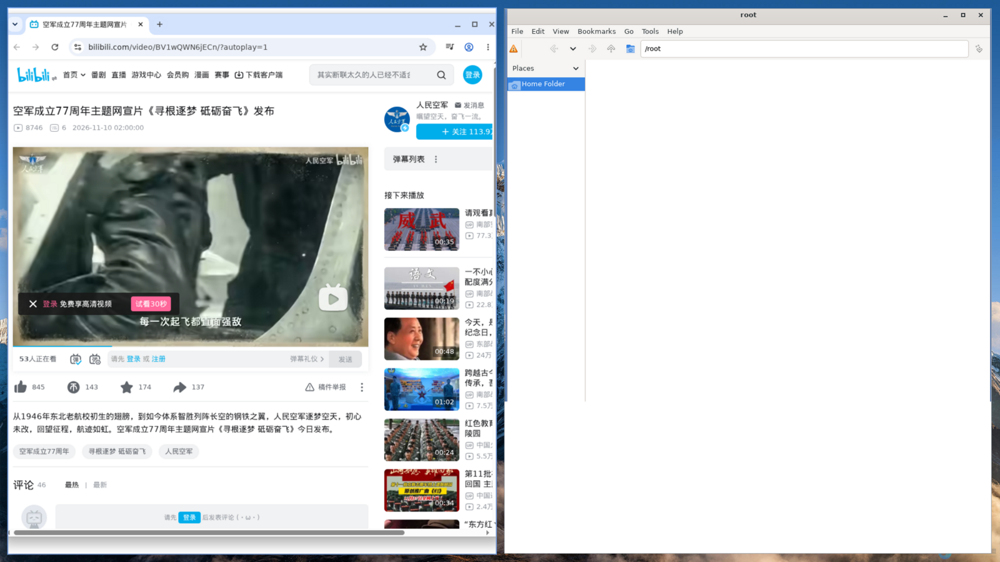
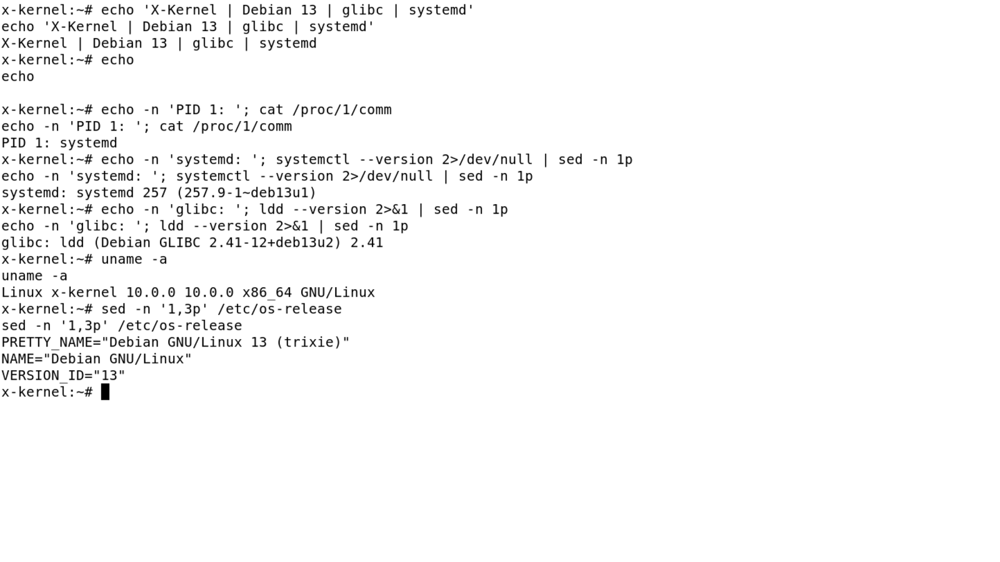

# X-Kernel

[中文版](README_CN.md) · [Repository](https://gitee.com/openkylin/x-kernel) · [Issues](https://gitee.com/openkylin/x-kernel/issues) · [Community](https://x-kernel.zulipchat.com)

[](LICENSE)

X-Kernel is a monolithic kernel written in Rust that targets the Linux ABI. It runs Linux userspace built for musl/glibc on x86_64, AArch64, RISC-V 64, and LoongArch64, provides in-kernel TEE support for confidential-computing guests, and runs Wayland/X11 desktop workloads including Chromium, niri, and Xorg/Xwayland.

<p align="center">
  
</p>
<p align="center"><em>niri + Chromium (Bilibili) + PCManFM on X-Kernel (x86_64, virtio-gpu, 1600x900).</em></p>

Subsystems are separated into crates with explicit ownership boundaries; see [Source layout](#source-layout).


## Contents

- [Why X-Kernel](#why-x-kernel)
- [Quick Start](#quick-start)
- [Real Workloads](#real-workloads)
- [Platform Support](#platform-support)
- [Capability Status](#capability-status)
- [Desktop Workloads](#desktop-workloads)
- [Design](#design)
- [Verification](#verification)
- [Performance](#performance)
- [Configuration](#configuration)
- [Source Layout](#source-layout)
- [Documentation](#documentation)
- [Community and Contributing](#community-and-contributing)
- [Security](#security)
- [Known Limitations](#known-limitations)
- [License](#license)
- [Acknowledgements](#acknowledgements)

## Why X-Kernel

- **Linux ABI with production userspace.** X-Kernel implements a Linux-compatible syscall and POSIX surface in `core/ksyscall`, `posix/`, and `api/linux_sysno`. systemd boots as PID 1 with glibc, Docker hello-world runs, and Wayland/X11 desktops run on the same kernel; the Starry Test Harness exercises the ABI from user space.
- **Four architectures.** x86_64, AArch64, RISC-V 64, and LoongArch64 are supported; x86_64, AArch64, and RISC-V are continuously built and tested.
- **Confidential computing in the kernel.** Hygon CSV has hardware-rooted key derivation (HUK) and attestation. ARM virtCCA has HUK derivation; pKVM is an experimental guest mode. TEE support includes TA (Trusted Application) lifecycle, secure storage, and SM2/ECC/RSA through RustCrypto.
- **Desktop-ready graphics.** DRM/KMS, virtio-gpu 2D/3D, EDID, page-flip/vblank, fbdev, and virtio-input support Chromium (Wayland), niri, and Xorg/Xwayland, including keyboard/mouse input and host-window resize. The compositor and rootfs are userspace artifacts; the kernel provides the display, GPU, and input interfaces.
- **Linux-baselined verification.** In-kernel tests, the [Starry Test Harness](https://gitee.com/openkylin/starry-test-harness), and TEE tests cover syscall, filesystem, network, desktop, and confidential-computing workloads.

## Quick Start

### Prerequisites

| Requirement | Notes |
|---|---|
| Rust | Use the toolchain pinned by `rust-toolchain.toml`. |
| QEMU | A matching system emulator for `make run`. |
| `cargo-binutils`, `rust-objcopy` | Required for kernel image generation. |
| Musl cross toolchain | Only for uapps, TEE tests, and Harness guest cases. The kernel build itself does not compile C; see [Cross toolchains](#cross-toolchains). |
| Rootfs tools | `curl` and `xz` for `make rootfs`. |
| x86_64 boot media | OVMF/EDK2 for UEFI, `mkfs.fat` and mtools for FAT media, and a GNU i386 toolchain for the LinuxBoot setup code. |
| Unit-test coverage | `debugfs`, `rust-profdata`, and `rust-cov`. |
| Repository hygiene | `make install-tools` for the pinned `cargo-shear`, `licensure`, and dylint tools. |

The CI builder image provides the CI build environment (the project toolchain is installed by CI); see [`scripts/ci/docker/`](scripts/ci/docker/) and [`docs/jenkins-pipeline.md`](docs/jenkins-pipeline.md). The complete prerequisite reference is in [`docs/ai/skills/build-workflow/SKILL.md`](docs/ai/skills/build-workflow/SKILL.md).

### Build and run

```bash
# AArch64 QEMU: the shortest path
cp platforms/kplat-aarch64/qemu_defconfig .config
make defconfig
make rootfs          # needs curl and xz
make build
make run
```

```bash
# x86_64 QEMU, with optional UEFI boot
cp platforms/kplat-x86_64/qemu_defconfig .config
make defconfig
make run
make run UEFI=y
```

`make run` uses LinuxBoot on x86_64 by default; `make run UEFI=y` selects OVMF/UEFI. Custom firmware paths can be supplied with `OVMF_CODE` and `OVMF_VARS_TEMPLATE`.

For x86_64 CSV, `scripts/start.sh` builds the UEFI image and starts QEMU with SEV. It needs OVMF plus the SEV launch artifacts (`cvm_1_launch_blob.bin` and `cvm_1_guest_owner_dh.cert` by default).

```bash
bash scripts/start.sh
```

### Real workloads

These are the end-to-end workloads that distinguish X-Kernel from a syscall-only Linux ABI implementation.

| Workload | Command | Expected |
|---|---|---|
| systemd + glibc | `make rootfs ROOTFS_VARIANT=debian-systemd` | systemd + glibc reach a shell |
| Docker | `docker run --network=host --rm hello-world` | `Hello from Docker!` |
| Wayland desktop | `make run GRAPHIC=y DISK_IMG=<desktop-image>` | Chromium/niri/Xorg starts |




*systemd 257 + glibc 2.41 on Debian 13 (x86_64, systemd `debian-systemd` rootfs).*

### Run options

```bash
make run XKMAKE_ARGS='--memory 2g --smp 2 --no-net'
make run XKMAKE_ARGS='--no-vsock'
make run QEMU_ARGS='-d guest_errors'
make run QEMU_ARGS='-no-reboot'
```

`XKMAKE_ARGS` is forwarded to xkmake; `QEMU_ARGS` is appended verbatim after `--` and is the right place for raw QEMU flags. `GRAPHIC=y` adds a GTK display and virtio keyboard/mouse; pair it with a desktop rootfs to run Chromium, niri, or Xorg/Xwayland; see [Desktop workloads](#desktop-workloads):

```bash
# Use a Wayland/X11-enabled desktop rootfs for these workloads.
make run GRAPHIC=y GPU_XRES=1920 GPU_YRES=1080
```

The default `make rootfs` image is a console image. Desktop rootfs and compositor images are maintained as separate userspace artifacts; they are not required to build or boot the kernel.

### Unit tests

```bash
make unittest
make unittest UNITTEST_CRATE=kvfs,kprocess
make ci-test          # clones the Starry Test Harness and runs the CI suite
```

With coverage enabled (the default), successful unit-test runs generate `coverage.txt`, `coverage.info`, and `coverage.xml` under `target/<rust-target>/<profile>/`.

### Cross toolchains

These are needed for uapps, TEE tests, and Harness guest cases; the kernel build does not compile C.

| Architecture | GCC | Musl | Download |
|---|---|---|---|
| x86_64 | 11.2.1 | git-b76f37f (2021-09-23) | [musl.cc](https://musl.cc/x86_64-linux-musl-cross.tgz) |
| aarch64 | 11.2.1 | git-b76f37f (2021-09-23) | [musl.cc](https://musl.cc/aarch64-linux-musl-cross.tgz) |
| riscv64 | 11.2.1 | git-b76f37f (2021-09-23) | [musl.cc](https://musl.cc/riscv64-linux-musl-cross.tgz) |
| loongarch64 | 13.2.0 | 1.2.5 | [LoongsonLab](https://github.com/LoongsonLab/oscomp-toolchains-for-oskernel/releases/download/loongarch64-linux-musl-cross-gcc-13.2.0/loongarch64-linux-musl-cross.tgz) |

## Platform Support

### Supported targets

| Target | Defconfig | Notes |
|---|---|---|
| x86_64 QEMU | [`qemu_defconfig`](platforms/kplat-x86_64/qemu_defconfig) | Default x86_64 target. |
| x86_64 CSV | [`qemu_csv_defconfig`](platforms/kplat-x86_64/qemu_csv_defconfig) | CSV HUK + attestation; [`scripts/start.sh`](scripts/start.sh). |
| AArch64 QEMU | [`qemu_defconfig`](platforms/kplat-aarch64/qemu_defconfig) | Default AArch64 target. |
| RISC-V 64 QEMU | [`qemu_defconfig`](platforms/kplat-riscv64/qemu_defconfig) | RISC-V 64 target. |

### Additional targets

| Target | Defconfig | Notes |
|---|---|---|
| AArch64 crosvm | [`qemu_crosvm_defconfig`](platforms/kplat-aarch64/qemu_crosvm_defconfig) | AArch64 crosvm target. |
| AArch64 virtCCA | [`qemu_virtcca_defconfig`](platforms/kplat-aarch64/qemu_virtcca_defconfig) | AArch64 virtCCA guest; HUK derivation. |
| AArch64 RK3588 | [`rk3588_defconfig`](platforms/kplat-aarch64/rk3588_defconfig) | Orange Pi 5 Plus; UART console. |
| LoongArch64 QEMU | [`qemu_defconfig`](platforms/kplat-loongarch64/qemu_defconfig) | LoongArch 64 target. |
| Kylin-x pKVM | No defconfig | Kylin pKVM guest feature flags. |

## Capability Status

Status: **Implemented** means present and exercised by a test or workload; **Partial** means present but covering a known subset; **Not yet** means not available in `main`.

| Area | Status | Scope and known gaps | Source |
|---|---|---|---|
| Memory management | Implemented | Address spaces, faults, COW, `mmap`/`brk`; Linux-semantics subset. | `mm/` |
| Process and scheduling | Implemented | `fork`/`exec`, `wait*`, signals, futex, timers, EEVDF scheduling. | `process/`, `task/` |
| VFS and path resolution | Implemented | `namei`, mount traversal, `openat2` `RESOLVE_*` constraints; Linux subset. | `fs/kvfs` |
| ext4 | Partial | Read/write and project quota; no full xfstests pass. | `fs/filesystems/kext4` |
| Other filesystems | Partial | tmpfs/ramfs, procfs, sysfs, devfs/devpts, pipefs, 9p, fat, cgroup2fs, bpffs; coverage varies. | `fs/filesystems/` |
| Networking | Partial | TCP/IP, Unix sockets, netfilter, vsock, netlink, TIPC; Linux subset. | `net/knet` |
| Drivers and device model | Implemented | Typed driver core; virtio blk/net/gpu/input/console; PCI and IRQ infrastructure. | `drivers/`, `io/` |
| Graphics (kernel) | Partial | DRM/KMS, virtio-gpu 2D/3D, EDID, page-flip/vblank, fbdev; single-scanout virtio-gpu path. | `io/drmdevice`, `io/fbdevice`, `io/inputdev` |
| Desktop workloads | Implemented | Chromium (Wayland), niri, and Xorg/Xwayland; keyboard/mouse input and host-window resize. | userspace compositor + `io/drmdevice`, `io/inputdev` |
| TEE | Implemented | TA (Trusted Application) lifecycle, secure storage, SM2/ECC/RSA via RustCrypto; CSV HUK + attestation; virtCCA HUK. | `tee/`, [`docs/tee.md`](docs/tee.md) |
| Container guest | Partial | `docker run --network=host --rm hello-world` smoke; user-namespace and cgroup gaps remain. | `uapps/mini-oci`, [`docs/container-architecture.md`](docs/container-architecture.md) |

### Desktop workloads

The desktop path uses the kernel's DRM/KMS, virtio-gpu (2D/3D, EDID), and virtio-input drivers. Validated userspace includes:

- **Chromium (Wayland)** — windowing, frame callbacks, and keyboard/mouse input.
- **niri** — reference compositor disk built from niri v26.04; host-window resize and pointer/keyboard input.
- **Xorg/Xwayland** — X11 workloads through the Xorg/Xwayland path.

Compositor and desktop rootfs images are maintained as separate userspace artifacts; the kernel build and boot do not depend on them. The reference desktop image is maintained in [openkylin/x-agentos](https://gitee.com/openkylin/x-agentos).

## Design

X-Kernel is monolithic at runtime but componentized by contract. The security value is API isolation and scoped audit, not runtime isolation between crates.

- **API-first ownership.** `mm/memspace`, `core/kuaccess`, `process/kexec`, and `kirq`/`device_res` are separate contracts, not implementation details of one catch-all crate. More than 200 crates define the ownership map.
- **Audit boundaries.** Each crate carries `docs/design.md` and `docs/security.md` where present; a reviewer can scope a change to its API contract and downstream users.
- **Unsafe boundaries.** Every `unsafe` block needs a `SAFETY:` justification; unsafe-heavy areas (MMIO, DMA, context switch, TEE glue) stay behind subsystem APIs.
- **Isolation boundaries.** Crate boundaries are compile-time, not privilege boundaries. TEE provides the runtime isolation for TA/guest workloads; the kernel remains a single address space.

```text
Linux userspace: systemd / Docker / Wayland / X11
------------------------------------------------
ABI: ksyscall / posix / tee
------------------------------------------------
subsystems: mm | process/task | fs | net | drivers/io
------------------------------------------------
arch HAL: x86_64 | AArch64 | RISC-V 64 | LoongArch64
------------------------------------------------
platforms: QEMU | crosvm | virtCCA | CSV | RK3588
```

## Verification

Verification runs at three layers:

- in-kernel unit tests (`make unittest`);
- Linux/POSIX userspace regressions through the [Starry Test Harness](https://gitee.com/openkylin/starry-test-harness) (`make ci-test`);
- TEE tests for secure storage and crypto.

The Harness also carries LTP, Open POSIX, libc-test, filesystem, network, desktop, and container workloads.

## Performance

Performance is workload-dependent: compute, scheduler, and pagecache paths are competitive with Linux; storage and TCP throughput are the main remaining gaps.

## Configuration

```bash
make menuconfig        # edit the configuration
make olddefconfig      # non-interactive refresh after Kconfig changes
make savedefconfig     # write a minimal ./defconfig
```

`make defconfig` expands a copied platform `defconfig` into a full `.config`. Build output is placed under `target/xkmake/<platform>/<profile>/`. Kernel configuration and build orchestration are described in [`docs/xkmake-design.md`](docs/xkmake-design.md).

## Source Layout

| Path | Role |
|---|---|
| `arch/` | Architecture HAL: CPU, exceptions, paging, timers, IPI. |
| `boot/` | Boot protocol handoff, early stubs, kernel image parsing. |
| `core/` | Syscall dispatch, runtime, tracing, user-memory access, services. |
| `mm/` | Address spaces, VMAs, faults, page cache, allocators. |
| `process/`, `task/` | Processes, threads, signals, scheduling, futexes. |
| `fs/` | VFS (`fs/kvfs`) and filesystem implementations. |
| `net/` | TCP/IP stack, sockets, netfilter, vsock, netlink. |
| `drivers/`, `io/` | Driver core, virtio, PCI, interrupt and display/input subsystems. |
| `tee/` | TEE kernel, TA lifecycle, secure storage, crypto. |
| `platforms/` | Platform glue and platform `defconfig`s. |
| `util/` | Shared utility crates. |

Crate-local design and threat-model notes live in `docs/design.md` and `docs/security.md` next to the code, where present.

## Documentation

- [Release policy](docs/release.md) and [v0.1.0-2606 release notes](docs/releases/v0.1.0-2606.md)
- [TEE build guide](docs/tee.md)
- [Container architecture](docs/container-architecture.md)
- [Jenkins pipeline contract](docs/jenkins-pipeline.md)
- [XKMake design](docs/xkmake-design.md)
- [Code guidelines](docs/code-guidelines/README.md)
- [Build workflow and prerequisites](docs/ai/skills/build-workflow/SKILL.md)

## Community and Contributing

- Repository: <https://gitee.com/openkylin/x-kernel>
- Issues: <https://gitee.com/openkylin/x-kernel/issues>
- Pull requests: <https://gitee.com/openkylin/x-kernel/pulls>
- Chat: <https://x-kernel.zulipchat.com>

Before opening a pull request:

1. Read [`docs/code-guidelines/README.md`](docs/code-guidelines/README.md) and the crate-local `docs/design.md` / `docs/security.md`.
2. Run `make fmt`, `make clippy`, and the narrowest relevant `make unittest` command.
3. Run `make ci-test` when the change affects syscall or userspace behavior.
4. Keep refactoring commits separate from feature or behavior commits, and update design/security documentation with the code.

## Security

X-Kernel uses Rust's memory-safety model, explicit `unsafe` boundaries with `SAFETY:` justifications, and TEE isolation for confidential-computing workloads.

Please report suspected vulnerabilities privately to the maintainers rather than opening a public issue.

## Known Limitations

- Linux ABI coverage is a subset; some syscalls, filesystem/network features, and memory-management paths remain incomplete.
- Platform maturity varies; some targets require additional setup and have lighter test coverage.
- Desktop and container end-to-end runs are outside the default CI path; CI focuses on the kernel-side build and unit tests.
- Performance is workload-dependent: compute, scheduler, and pagecache results are competitive; storage and TCP throughput still trail Linux.

## License

Licensed under the Apache License 2.0. See [LICENSE](LICENSE) and [NOTICE](NOTICE).

## Acknowledgements

X-Kernel is inspired by [StarryOS](https://github.com/Starry-OS/StarryOS) and [ArceOS](https://github.com/arceos-org/arceos).
