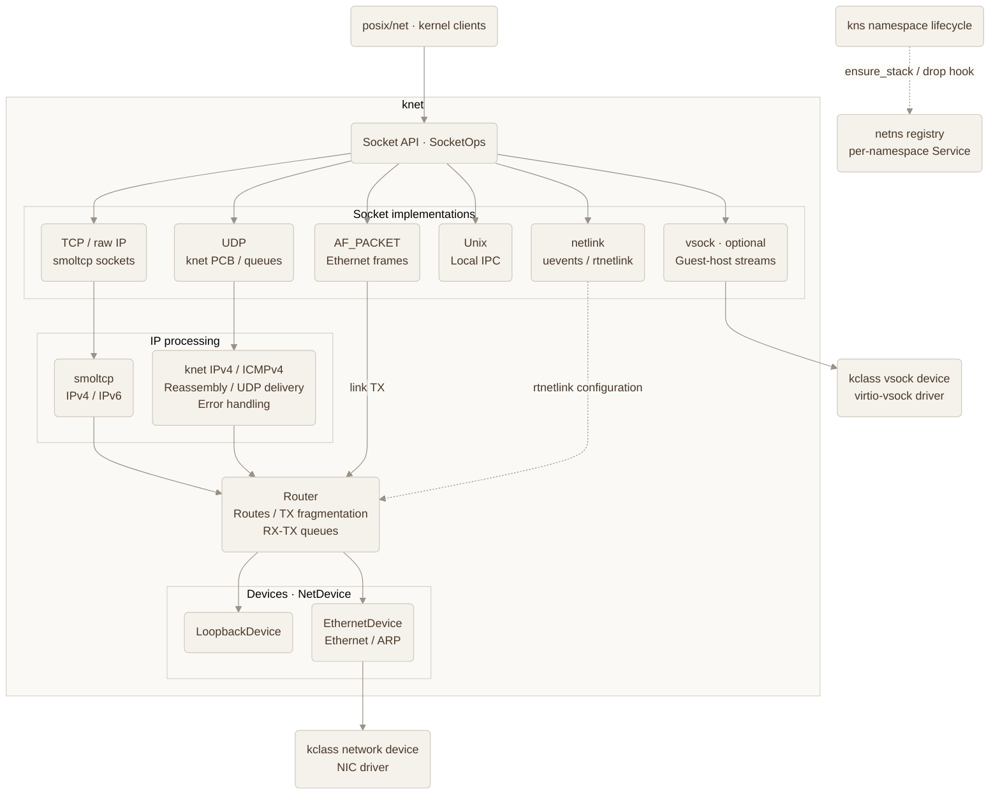
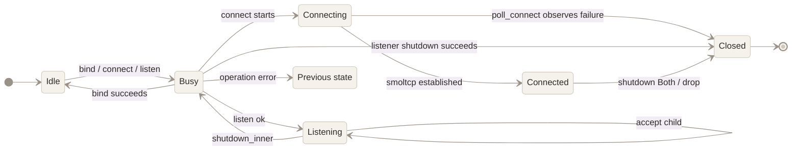
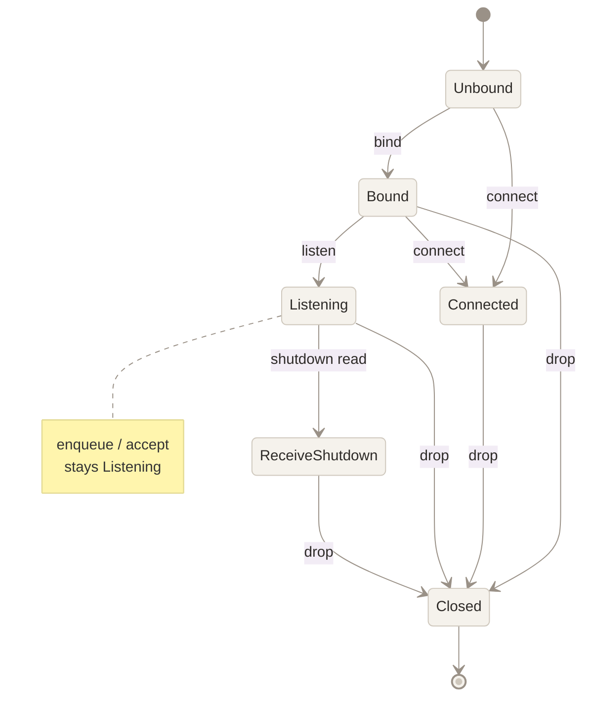
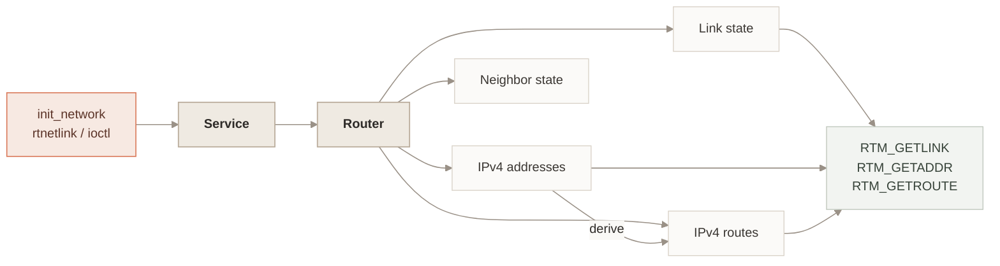
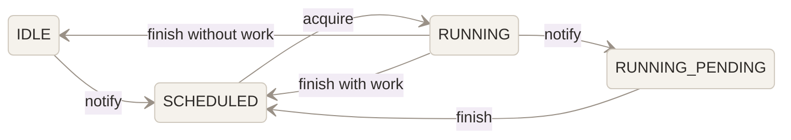

# knet — Design

## Fallible Protocol-Stack Device Owners

The registry and Router own protocol-stack devices through `KBox<dyn NetDevice>`.
This does not change portable driver-class owners. Boot reserves both loopback
and optional Ethernet storage with KERNEL before constructing devices, attaching
NIC notification sources, or publishing SERVICE. The boot caller handles owner
failure at its explicit fatal-boot boundary; ordinary constructors return errors.

`PreparedStack` prepares an unpublished loopback-only namespace stack in
reclaim-safe sleepable task context. `ensure_stack` checks the registry, prepares
outside its lock, and rechecks before insertion. A concurrent winner is retained;
the unused candidate is destroyed outside the registry lock. The namespace is
borrowed throughout installation, preventing identity destruction during publish.
Clone prepares before child relationships exist, then installs without another
fallible owner allocation. Unshare and setns prepare before switching namespaces.
Dropping a namespace removes its installed stack through the existing drop hook.

String, Vec, BTreeMap and Arc allocations retain their existing infallible policy.
This is not a whole-stack OOM guarantee or per-namespace data-plane isolation.
Tests inject owner failure, check retry/idempotence, and deterministically publish
a competing stack during preparation to exercise the recheck path.

## Poller Configuration Preparation

The private poller prepares QueueConfig CPU storage with KERNEL permissions in
sleepable, reclaim-safe startup context, after releasing its state lock. Failure
is logged and returns before queue creation or publication, like the existing
NormalQueue preparation failure. Pending demand remains recorded, but both
background polling and foreground assistance return without progressing the
network while the queue is absent. A later explicit start can retry; the current
boot path calls start only once. No automatic
retry or allocation-free guarantee for the complete network startup is added.

## Fallible socket owners

The seven `Socket` variants own `KBox<T>`; SocketOps and Configurable forwarding
retain concrete protocol behavior. POSIX socket construction allocates owners
with KERNEL permissions before fd publication, without holding the fd-table lock.
Failure destroys the constructed socket using its existing transport cleanup.

TCP, Unix and vsock accept reserve owner storage before entering transport
accept or dequeuing a pending connection. TCP validates listening state and the
bound endpoint first. Reservation failure returns NoMemory without consuming a
connection; transport errors, interruption and WouldBlock release unused storage.
Success writes into that storage without another owner allocation. No queue or
socket-set lock spans reservation; Unix endpoint snapshots are taken afterwards.

Even nonblocking accept requires sleepable, reclaim-safe task context without
locks needed by reclaim: nonblocking controls connection waiting, not allocator
permissions. NoMemory can precede empty-queue WouldBlock; Unix/vsock reservation
can also fail before transport validation. Each blocked accept retains one
reserved slot, avoiding connection loss without a queue rollback protocol.
Portable driver-class owners, boxed packet buffers, async-trait futures,
nested Arc/Vec allocations and dynamic workers remain outside this migration.

## Bridge receive buffers

The vsock-TIPC bridge owns each fixed-size receive buffer as `KBox<[u8]>`.
RX and TX tasks prepare it with KERNEL permissions outside port, channel,
bridge and connection-manager locks, in sleepable, reclaim-safe context.
Connection constructors consume the prepared buffer without allocating it again.
The temporary Vec used solely to construct the old boxed slice is removed;
ordinary message Vecs, connection lists and nested allocations are unchanged.

For host-originated requests, preparation failure aborts the existing manager
connection through `abort_bridge`, even if sending the reset fails, and publishes
no bridge entry. Reverse TIPC accepts validate the peer first, then prepare the
buffer before vsock admission. Failure closes the accepted channel and returns
the allocation error; it does not restore that channel to the accept queue.
The pre-connect hook remains infallible with respect to buffer ownership.

## Test Layout

Guest tests live in `ut-tests/`, mirroring the source module hierarchy, and
use `unittest::path_mod_test!` at the original scope. Netlink and socket test
helpers move with their cases. Runtime timer probes retain their original
hang bounds and observe the boot-created service; migration does not install
another service or change its registration.

## Role

`knet` provides a kernel network stack for x-kernel, which combines driver-level network devices, protocol stack, socket objects, poll and wakeup mechanisms, Unix domain sockets, netlink, and optional vsock support into a unified `SocketOps` interface. It is mainly responsible for protocol state, routing, RX/TX progress, and socket semantics. It uses crate-local IPv4, UDP, and ICMPv4 data paths to handle UDP send and receive, fragmentation, and error reporting. smoltcp supplies TCP, raw IP, IPv6, and staged interface polling.

`NetDevice::poll_rx` returns `KResult<RxPoll>`. Ethernet consumes at most one
driver frame per call. `RxPoll::Empty` means the budgeted receive step consumed
no frame or deferred packet;
`RxPoll::Consumed` charges one unit of device RX budget and carries an optional
IP packet. ARP, malformed frames, and filtered or unsupported traffic consume
budget even when no packet reaches the IP stack. Receive and recycling failures
retain their mapped `KError`.
Loopback runs its stamped-UDP fallback with a separate entry-time round bound
before polling one deferred packet. The fallback is outside the Router's device
RX budget, so `RxPoll::Empty` can follow successful direct UDP delivery.
`RxDrain` reports the failing interface and error alongside any earlier packets
in the batch, and advances the device cursor. The service logs that error and
ends the RX round after handling the partial batch. A packet decoded during a
failed recycling operation is dropped; a later round may retry. The driver owns
the consumed buffer handle even on error.

## Background

x-kernel needs socket semantics that can serve both POSIX syscalls and in-kernel clients. `knet` owns protocol state, packet queues, routing, and progress scheduling, while its surrounding subsystems supply device access, task scheduling, filesystem operations, and caller context.

The POSIX network layer in `posix/net` handles syscall arguments, user-memory access, file descriptors, and ABI conversion. `kvfs` owns pathname resolution and access checks, and `anon_inodefs` creates socket files. `kclass` supplies registered network and vsock device handles; concrete drivers own hardware and virtqueue operations. `kirq` supplies the generic softirq mechanism, while `ktask`, `kworkng`, and `kpoll` supply timer callbacks, task-context polling, and readiness registration. `kns` supplies network-namespace identity (`NetNamespace`, the boot namespace's id) and installs this crate's drop-notification hook; `kidentity` supplies the process-identity type (`PidHandle`) that Unix sender credentials carry instead of a numeric PID. `knet` owns the per-namespace protocol stacks keyed by that identity. `knet` determines how these facilities advance network work.

## Scope

The layout below shows the implementation and the kernel unit-test directory.
Tests in `ut-tests/` are loaded from their source modules with
`unittest::path_mod_test!` under `cfg(unittest)`.

```text
net/knet/
├── Cargo.toml
├── ut-tests/
└── src/
    ├── device/
    │   ├── ethernet.rs
    │   ├── id.rs
    │   ├── loopback.rs
    │   ├── mod.rs
    │   ├── net_rx.rs
    │   └── registry.rs
    ├── link/
    │   ├── buf.rs
    │   ├── mod.rs
    │   ├── packet.rs
    │   └── wire.rs
    ├── netfilter/
    │   ├── mod.rs
    │   ├── compat/
    │   │   ├── mod.rs
    │   │   └── iptables_legacy/
    │   │       ├── mod.rs
    │   │       ├── abi.rs
    │   │       ├── decode.rs
    │   │       ├── encode.rs
    │   │       ├── query.rs
    │   │       └── restore.rs
    │   └── filter/
    │       ├── mod.rs
    │       ├── matcher.rs
    │       ├── packet.rs
    │       ├── chain.rs
    │       ├── error.rs
    │       ├── rule.rs
    │       └── table.rs
    ├── netlink/
    │   ├── mod.rs
    │   ├── port.rs
    │   ├── rtnetlink.rs
    │   ├── socket.rs
    │   └── wire.rs
    ├── netns.rs
    ├── network/
    │   ├── event.rs
    │   ├── ipv4/
    │   │   ├── mod.rs
    │   │   └── process.rs
    │   ├── interface_address.rs
    │   ├── fragment.rs
    │   ├── mod.rs
    │   └── router.rs
    ├── runtime/
    │   ├── mod.rs
    │   ├── poller.rs
    │   ├── service.rs
    │   └── tx_queue.rs
    ├── socket/
    │   ├── file.rs
    │   ├── general.rs
    │   ├── mod.rs
    │   ├── options.rs
    │   └── state.rs
    ├── stack/
    │   ├── ingress.rs
    │   ├── mod.rs
    │   ├── device.rs
    │   ├── router.rs
    │   ├── socket_set.rs
    │   └── time.rs
    ├── transport/
    │   ├── udp/
    │   │   ├── input.rs
    │   │   ├── mod.rs
    │   │   ├── output.rs
    │   │   ├── pcb.rs
    │   │   ├── registry.rs
    │   │   ├── relay.rs
    │   │   ├── socket.rs
    │   │   ├── state.rs
    │   │   └── wait.rs
    │   ├── listen_table.rs
    │   ├── mod.rs
    │   ├── raw.rs
    │   ├── tcp.rs
    │   └── udp_err.rs
    ├── unix/
    │   ├── stream/
    │   │   ├── channel.rs
    │   │   └── listener.rs
    │   ├── dgram.rs
    │   └── stream.rs
    ├── vsock/
    │   ├── bridge.rs
    │   ├── bridge_connection.rs
    │   ├── bridge_port_map.rs
    │   ├── connection_manager.rs
    │   └── stream.rs
    ├── consts.rs
    ├── control.rs
    ├── ip.rs
    ├── lib.rs
    ├── unix.rs
    └── vsock.rs
```

## Architecture



Solid arrows show the main API and packet-path relationships; the dotted arrow
shows rtnetlink configuration through `control` and the owning components.
`Service` coordinates IP processing and `Router`; `poller` advances RX, protocol
timers, and TX through kworkng or socket-assist polling. AF_PACKET receives frame
subscriptions from `EthernetDevice`, while Unix and vsock use their own transports.

| Component | Responsibility |
|---|---|
| posix/net · kernel clients | Call the socket API from POSIX syscalls or kernel code. |
| Socket API · SocketOps | Provides common operations across socket implementations. |
| TCP / raw IP | Implements TCP and raw IP sockets using smoltcp. |
| UDP | Manages UDP PCBs and queues, using knet's IPv4 path for packet I/O. |
| AF_PACKET | Receives Ethernet frame subscriptions and sends frames through Router. |
| Unix | Provides local stream and datagram communication. |
| netlink | Owns port IDs and subscription masks, delivers kernel uevents and rtnetlink multicast notifications, and handles supported rtnetlink queries and configuration changes. |
| vsock | Provides optional guest-host stream communication through virtio-vsock. |
| smoltcp | Provides IPv4/IPv6 processing for the smoltcp socket path. |
| knet IPv4 / ICMPv4 | Validates and reassembles IPv4 packets, delivers UDP input, and handles ICMPv4 errors and responses. |
| DeviceRegistry | Owns registered interfaces and address configuration, validates mutations, and synchronizes device address projections and aggregate MTU. |
| Router | Selects routes, fragments outgoing IPv4 packets, and dispatches RX/TX queues across devices. |
| StackDevice | Borrows the admitted RX queue, data TX queue, and MTU for smoltcp; has no access to routes or physical devices. |
| LoopbackDevice | Returns locally transmitted packets to the receive path. |
| EthernetDevice | Adapts kclass network devices to knet's NetDevice interface and handles Ethernet and ARP. |
| kclass network device · NIC driver | Exposes the registered NIC and performs hardware packet I/O. |
| kclass vsock device · virtio-vsock driver | Exposes the registered vsock device and transports guest-host packets. |
| NetnsStacks (`netns.rs`) | Registry of per-network-namespace protocol stacks keyed by `kns` namespace id; materializes a private loopback-only stack for a new namespace via `ensure_stack` and releases it from the `kns` drop hook. |

`Router::stack_device()` constructs a temporary `StackDevice` for interface
initialization, ingress, and egress. Router still owns and serializes the queues;
this boundary separates the smoltcp adapter from routing and device dispatch
without changing lock order, queue capacity, or loopback delivery. A later queue
ownership change can replace the adapter's backing owner without exposing the
routing table to smoltcp again.

### IPv4 Header Views

`Ipv4Header` borrows header bytes, including options. `parse_header_only` checks
structure; `parse_input` also validates datagram bounds and the header checksum.
IPv4 processing trims padding and records the next-layer offset in `PacketBuf`;
`transport_packet()` reads from that offset to the packet end. Mutable network
access and truncation invalidate derived offsets, checksum state and UDP metadata.
Fragment data does not imply a complete transport header. ICMP quotes permit
truncated payloads; unfinished output derives its length from packet storage.

### IPv4 Filter Table Model

`netfilter/filter` stores IPv4 filtering policies as immutable ordered rules
with table-owned counters. Each table has INPUT, FORWARD, and OUTPUT chains for
the LOCAL_IN, FORWARD, and LOCAL_OUT hooks, plus named user chains. Rules hold match conditions
and a target; jumps refer to user chains by table-local `ChainId` values.
Match conditions and their evaluation methods live in `matcher.rs`;
rules, chains, and tables live in
`rule.rs`, `chain.rs`, and `table.rs`, respectively. Their construction errors
are defined in `error.rs`.

Rules validate extension counts and protocol compatibility, chains validate
their names, and tables enforce name uniqueness, hook coverage, aggregate limits,
and jump-graph constraints. Tables allow at most 256 chains, 4096 rules,
16 extensions per rule and 28-byte chain names.
Jump nesting is bounded by the chain count and the acyclic-graph requirement.
Chain-name lengths count UTF-8 bytes and follow the legacy iptables limit;
extension counts are an X-Kernel resource limit.

`FilterTable::evaluate` accepts a `PacketBuf` normalized by IPv4
input validation or output preparation, plus the hook's interface names.
It prepares an internal `MatchContext` once before traversing rules, borrowing
the header and `transport_packet()` payload from that buffer.
`packet.rs` owns this read-only context and the shared `MatchOutcome` result.
`Rule::evaluate_match` calls `BaseMatch::evaluate`, then checks transport
extensions through `ExtensionMatch::evaluate` in rule order.
Both return `MatchOutcome`; any result other than `Matched` ends rule evaluation.
Each condition type owns its matching logic and reads the shared context
without repeating checksum validation or deriving independent payload bounds.
Missing packet bounds or an unparseable header return an error before evaluation
or counter recording; byte accounting uses the normalized network packet length.

The internal `FilterTable::evaluate_with_observer` executor implements Continue,
terminal verdicts, jumps, and RETURN.
User-chain RETURN and fallthrough resume after the caller's jump; built-in
RETURN and fallthrough apply the hook's policy. The executor directly updates
matched rules and reached chain tails, then reports those events to an observer.
`evaluate` uses the same executor with a no-op observer.
Short transport headers and TCP fragments at offset eight bytes hot-drop.
Each evaluation examines at most 4096 rules, counting repeated user-chain visits;
budget exhaustion drops the packet even for an otherwise valid acyclic table.
The budget is an X-Kernel limit added to Linux's traversal semantics.

`filter/counter.rs` defines `EntryCounter` for atomic packet and byte totals,
and plain `FilterCounter` and `ChainCounters` values for batch updates and exports.
Each `Rule` owns its hit counter; each `Chain` owns its completion counter.
Their constructors initialize counters to zero. Runtime rules and chains do not
implement cloning or equality; management reads their semantic fields and
collects counter values separately.
`FilterTable` validates the complete update shape before adding any counters,
and collects counters by traversing its chains and rules.
Live counter fields are sampled independently: packet/byte pairs, separate
rules, and batch additions need not appear at one instant. After updates stop,
collection returns the final totals.

`filter/config.rs` manages publication generations and replacement. Each
`FilterState` holds a generation and directly owns its `FilterTable`. The table
owns both rules and counters; the configuration delegates execution, batch
addition, and counter collection to it. A state's table accessor borrows the table.

`FilterConfig::with_state` borrows one `FilterState` under a shared lock without
copying its contents. Callers can inspect its generation, borrow the table's
rules, and collect counters only when needed. Counter sampling can run alongside
evaluation and batch additions while the shared lock keeps the table, generation
and counter layout paired. No separate snapshot model is maintained. Evaluation
holds the shared lock for one complete packet traversal.

Replacement takes an exclusive lock to wait for all old-generation updates
through the configuration, checks the current generation, moves out the old
state, and publishes the new state. It releases the lock before returning
ownership of the old generation. Callers must not evaluate or add counters to
retired tables. Their final counters can then be collected and their resources
released outside the publication lock. The swap transfers table ownership
without copying rules or counters.

Generations are `u64` sequences scoped to one configuration instance: they start at zero and
advance under the publication write lock only on successful replacement.
Generation exhaustion rejects publication rather than reusing an earlier value.
Rejected updates preserve the current state. These operations require sleepable
task context; table construction and counter collection allocate bounded storage.
The global store starts with empty ACCEPT chains.

### Legacy IPv4 Table Compatibility

`netfilter/compat/iptables_legacy` exports tables in the native
64-bit legacy IPv4 iptables format.
`abi.rs` defines the fixed ABI layouts; `encode.rs` converts table layout metadata
into `IptGetInfo`, converts base conditions and TCP/UDP/ICMP matches into ABI
records, and assembles entries with standard targets or ERROR chain markers.
The caller supplies an exactly sized output buffer and resolves verdicts or jump
offsets for standard targets.
Encoding checks ABI field widths, allocates no memory, and zeroes counters,
reserved bytes, and padding.
Conditions without an equivalent legacy representation return an error.

`LegacyExtension` defines the names, revisions, and sizes used by both encoding
and decoding. `decode.rs` reads one entry from a kernel byte slice into an owned
`DecodedEntry`.
It checks record and extension bounds, alignment, revision zero, and the per-rule
extension limit. ABI conversions preserve supported address, interface, protocol,
and transport conditions; unsupported masks, flags, options, and targets fail.
`DecodedTarget` distinguishes verdicts, RETURN, `TableOffset` byte offsets, and
`ErrorTarget` markers for user chains or the table end. Table reconstruction must
resolve offsets, construct rules to validate protocol compatibility, and validate
the resulting chains before publication.
Decoding requires task context and ignores incoming counters, cache fields, and padding.

`decode.rs` also converts `LegacyTableInput` into a validated `FilterTable`.
`DecodedTable` converts hook, policy, and jump byte offsets to record indices
before building `ImportLayout`. Temporary byte positions are then discarded.
`ImportLayout` checks chain boundaries and maps user-chain entry indices to
chain IDs. The export-side `TableLayout` computes byte offsets from a validated
table. Hook entries and ERROR names define chain boundaries in entry order.
Built-in chains end at their declared unconditional policy; user chains end in an unconditional RETURN,
followed by another chain or the final ERROR marker. Only next-entry offsets and
jumps to a user chain's first rule can be restored. Rule, Chain, and FilterTable
constructors check protocol compatibility, names, resource limits, and cycles.
Record count and byte limits are derived from the model and supported ABI sizes.

In `restore.rs`, `LegacyFilterReplace` pairs the input table with the expected
old counter count. Its `replace` method finishes restoration before taking the
publication lock. It checks the expected old entry count under that lock, then publishes the
new zero-counter table. Final old counters are collected outside the lock in
legacy entry order. A validation or count conflict keeps the current state unchanged.
`LegacyTableHandle` implements writes in `restore.rs`. `ADD_COUNTERS` requires one counter per entry
and sends rule and chain-end counters to `FilterConfig::add_counters`. `ERROR` entry counters
are saved in the compatibility layer with their table generation. A mutex
serializes writes and entry exports before either takes the configuration lock;
packet matching needs only the configuration lock. Table replacement clears the saved `ERROR`
counters after returning the old counters. New tables ignore input counters.
The shared marker-counter mutex is initialized lazily on the first table lookup,
allowing its constructor to register a lock class when lock statistics are enabled.

`LegacyFilterTable` owns the complete entry array and its hook and policy offsets.
`collect_counters` and `split_counters` map counters between legacy entries and semantic chains.
`TableLayout` computes chain boundaries, total size, entry count, and hook and
policy offsets before output allocation. It resolves targets against those chain
positions and remains local to one conversion of the immutable source table.
`ChainLayout` records table-relative byte offsets; an empty chain's rules start
at its tail. `LegacyFilterTable::encode` initializes the output from the layout
and delegates each chain's marker, rules, counters, and tail to `encode_chain`,
then writes the terminal ERROR entry.
Jump offsets skip user-chain markers; Continue offsets select the next entry.
Rule and chain-end counters map to their rule and tail entries, while `ERROR` entries
use the passed marker counters (zero for standalone encoding, or the saved totals during export).
Output and scratch allocation require task context. Encoding failures discard
the output and leave the source table unchanged.

`mod.rs` defines `LegacyTableHandle` and resolves the `filter` name to the global
configuration. Query methods live in `query.rs`. The shared handle holds no lock
or table snapshot. Each `info()` or `export_entries()` call
reads the current generation independently: metadata uses only `TableLayout`,
while entry export validates the requested size and encodes under one read guard.
Rules and counter layout belong to that generation; live counters are sampled
independently.
A size mismatch returns `EAGAIN`; equal sizes across calls do not imply the same
generation. Exported bytes remain owned after later configuration changes.

`LegacyExtension` in `encode.rs` defines native record names, sizes, and revisions
for both encoding and `ExtensionKind::check_revision`. These declarations cover
the exported record formats; semantic matcher support and rule-import support
are separate capabilities. `abi_name` reserves the final byte of each fixed-width
name field for NUL and truncates the preceding prefix at its first NUL.
`mod.rs` defines `ExtensionKind`, checks revisions, and maps encoding errors to
kernel errors. An invalid encoder buffer size returns `EIO`, while invalid request
lengths return `EINVAL` at the POSIX boundary.
POSIX owns IPv4 socket selection, `CAP_NET_ADMIN`, request lengths, and user
copies, which run outside filter locks.
`SET_REPLACE` accepts a 96-byte native header and the declared entries, allowing
extra bytes at the end of the request. `ADD_COUNTERS` uses a 40-byte header and an exact counter
array. Memory allocation is checked against the table limits before copying user input.
A wrong old entry count returns `EAGAIN`; a wrong `ADD_COUNTERS` count returns
`EINVAL`. Once a new table is installed, a failed copy of old counters to user memory
does not undo the update or change its success return.

## Calling Constraints and Execution Context

`knet` runs in kernel context, but different code paths have different execution-context requirements. Callers must follow the constraints below.

* **Initialization order**

  `init_network` must complete before Internet sockets access `SERVICE`, `SOCKET_SET`, or `LISTEN_TABLE`, or routing and protocol processing begin. Unix sockets use their own transport and binding state; vsock initialization is handled separately by `init_vsock`. It initializes `SERVICE`, `SOCKET_SET`, `LISTEN_TABLE`, and the initial Router state. The dynamic workqueue used by `knet-poller` is started only after these objects are initialized.

* **vsock startup and callbacks**

  `init_vsock` installs the available raw transport and registers availability/removal callbacks. `start_vsock_bridge` must run after all scheduler run queues are initialized because it starts bridge tasks. Device availability and removal callbacks take sleepable locks. `publish_kobject_uevent`, `send_link_frame`, and relay operations also allocate or acquire sleepable locks and belong in task context. The periodic `Service::handle_timer_tick` callback uses atomic deadline checks, waiter notification, and IRQ-safe poller scheduling.

* **Normal protocol processing runs in task context**

  Paths such as `NetworkPoller::assist_once`, socket `send` / `recv` / `connect` / `accept`, and netlink mutations may acquire `Mutex` or `RwLock` objects and may execute relatively heavy data-plane work. These paths must run in normal task context.

* **IPv4 filter model construction**

  Construct filter policies in task context after allocator initialization.
  Table validation allocates temporary storage.

* **IPv4 filter evaluation**

  Evaluation is reentrant and allocates no heap memory. On 64-bit targets its
  fixed-capacity return stack reserves 4 KiB for frames plus length bookkeeping
  and covers the table's maximum chain count. Frames are initialized only when
  a jump pushes a return point.
  It needs no current process; callbacks must obey the caller's execution context.

* **IRQ handlers only signal RX work**

  A device interrupt handler should only acknowledge the device interrupt, mark RX work as pending, and schedule the `NetRx` softirq. It must not run full protocol processing or blocking socket operations directly.

* **`NetRx` may deliver loopback UDP, but must not call `NetworkPoller::assist_once`**

  `NetRx` runs in a non-sleepable context.

  For Ethernet devices, it only consumes pending RX sources, wakes the corresponding device RX `PollSet`, and schedules `knet-poller`. The actual data-plane processing then runs in kworkng task context and is bounded by the configured number of poll rounds.

  Loopback UDP uses a more direct path. Before BH is disabled, the transmit path validates the UDP packet and stores the source/destination information and payload range in the existing `PacketBuf` control metadata. The same `NetRx` action then drains only these prepared handles from `pending_udp`, looks up the PCB through the `SpinNoIrq` registry, moves the packet into a receive queue with reserved capacity, and wakes the socket waiter. The hot UDP delivery path therefore performs no heap allocation.

  TCP, ICMP, IPv6, fragmented packets, and UDP packets that do not match a socket remain in `deferred`. They are later drained by the task poller through `poll_rx`.

  Code running in softirq context must not call `NetworkPoller::assist_once` or acquire sleepable locks owned by `Service` or `SocketSet`.

* **Blocking operations depend on poll and waker semantics**

  Blocking socket operations rely on `PollSet`, wakers, and timeout registration.

  `Pollable::register` may register sources only through the caller-provided `PollContext`. The corresponding `PollRegistrations` must remain alive while the operation is in the `Pending` state. The caller must also recheck readiness after registration. This preserves cancellation cleanup and closes the race between the readiness check and source registration.

  A blocking Unix stream `connect` waits for listener backlog capacity through `event-listener` when the backlog is full. The wait is bounded by `SO_SNDTIMEO` and therefore requires scheduler support and an interruptible task context.

* **Global state is not tied to a fixed current process or thread**

  Shared access to `SERVICE`, `SOCKET_SET`, and Router state is mainly protected by global locks and atomic state. Syscall-specific semantics are still provided by `posix/net`, which supplies the process file-descriptor context and caller credentials.

  Netlink sends authorize the caller snapshot taken when the operation begins; the immutable `VfsFile` open credential does not participate in rtnetlink authorization. Unix datagram sends also take only the caller snapshot. Credentials are not cached in the socket itself.

* **Pathname Unix sockets require filesystem and credential context**

  Userspace `bind` and `connect` operations for pathname Unix sockets must run in a task that has a current thread and a valid filesystem context.

  Kernel callers without a current userspace task must use `bind_with_cred` to provide credentials explicitly, and the calling environment must still provide a valid filesystem context.

* **Concurrency is limited by global serialization points**

  Multiple execution paths may enter the crate concurrently. Critical access to `Service`, `SocketSet`, and listener backlog state is serialized by their corresponding locks.


## State Machines

### TCP Socket State

`TcpSocket` stores `socket::state::State` in `StateLock`. `Idle` permits initial setup, `Busy` serializes a transition, `Connecting` waits for the handshake, `Connected` represents an established endpoint, `Listening` owns a listener entry, and `Closed` records local full shutdown or connection failure. smoltcp maintains the separate TCP wire-protocol state; peer closure alone does not update this local enum.

TCP's `IP_TTL` configures the protocol socket's output hop limit. A listen entry
retains the listener handle and copies its current hop limit into each child
before processing the SYN, so handshake replies and accepted sockets use the
inherited value. Closing the listener marks its entry closed before releasing
the protocol handle.

TCP supports disabled `SO_LINGER` and zero-duration abortive close; positive
linger durations are rejected. Abortive close retains the protocol handle until
its RST has been dispatched. Incoming RST candidates are matched to a socket
before one ingress operation, and become pending errors only if protocol
validation closes that socket. The socket-set lock protects this observation and
the error record. Reads deliver queued bytes first; read, write and `SO_ERROR`
share one consumable error. Pending errors publish `ERR` readiness, while normal
FIN closure remains EOF. Handle removal clears its pending error.



| From | To | Trigger |
|---|---|---|
| `Idle` | `Busy` | `bind`, `connect`, or `listen` acquires `StateLock::lock`. |
| `Busy` | `Idle` | `bind` succeeds and records the local endpoint. |
| `Busy` | `Connecting` | `connect` starts the smoltcp connection. |
| `Busy` | `Listening` | `listen` registers the socket in `ListenTable`. |
| `Connecting` | `Connected` | `poll_connect` observes smoltcp `Established`. |
| `Connecting` | `Closed` | `poll_connect` observes a state other than `SynSent` or `Established`. |
| `Connected` | `Closed` | `shutdown_inner` handles `Shutdown::Both`, including the file-drop path. A directional shutdown only changes its shutdown flag. |
| `Listening` | `Busy` | `shutdown_inner` acquires the listener state lock. |
| `Busy` | `Closed` | Listener shutdown removes its entry and bound endpoint. |
| `Busy` | Previous state | The closure passed to `StateGuard::transit` returns an error. |

Accepted children start in `Connected`; `accept` leaves the listening socket in `Listening`.

### UDP Socket State

`UdpSocketState::lifecycle` is an `RwLock<UdpSocketLifecycle>` initialized to `Init`. Its setters define these local transitions:

| Update | Resulting state |
|---|---|
| `set_local_endpoint(Some(...))` | `Bound`, with a local endpoint recorded. |
| `set_local_endpoint(None)` | `Init`, with the local endpoint cleared. |
| `set_peer_endpoint(Some(...))` | `Connected`, with peer filtering enabled. |
| `set_peer_endpoint(None)` | `Bound` if a local endpoint remains, otherwise `Init`. |
| `shutdown(Shutdown::Both)` | `Closed`; directional shutdown updates its atomic flag without changing the lifecycle. |

These setters assign the result from their arguments and current endpoint fields. The lifecycle records socket setup and readiness, independently of the PCB's registry membership.

The stored local endpoint remains the original binding. While connected,
`local_endpoint()` combines its port with the source address stored alongside
the peer. Address queries and send-source selection use that effective endpoint.
The registry derives the same local address from one peer/source snapshot for
receive matching and bind-conflict checks, without taking a sleepable state lock
in `NetRx`. Clearing the peer restores the original explicit binding; automatic
bindings are removed by disconnect.

### Unix Seqpacket Transport

`SOCK_SEQPACKET` is connection-oriented like a stream socket and
message-oriented like a datagram socket, so it has its own transport rather than
reusing either neighbour. `bind` publishes a bounded rendezvous in
`BindEntry::seqpacket`; `listen` marks it accepting; `connect` creates the two
`async_channel` queues of the connection, queues both client ends in the
rendezvous, and returns without waiting for `accept`, matching Linux queueing a
connection that the peer may not have accepted yet. `accept` takes one entry
out and owns the server ends. `accept` on a bound socket that has not called
`listen` fails with `EINVAL` instead of waiting; after a read shutdown it still
drains connections queued earlier, then returns `EINVAL`. A message is one
`Datagram`: `send` copies the caller's bytes into one queued record and fails
with `EMSGSIZE`-style loss as `BrokenPipe` if the peer is gone, while `recv`
consumes exactly one record and truncates it when the caller's buffer is short,
discarding the remainder. The socket keeps the type it was created with, so
`SO_TYPE` reports `SOCK_SEQPACKET` even though the queues are shared with the
datagram transport.

`shutdown(SHUT_WR)` drops only this side's sender and keeps the connection
record, so the peer observes EOF, a second `connect` still fails with `EISCONN`,
and `SO_PEERCRED` remains available. `shutdown(SHUT_RD)` closes the receive
channel after retaining already-queued records, makes the peer's sends fail, and
stops a listener from queueing new connections; queued connections can still be
accepted, and once the queue is empty `accept` returns `EINVAL`. A shutdown
issued before `connect` is applied when the connection is installed: a pending
read shutdown closes the new receive channel so peer sends fail immediately,
and a pending write shutdown leaves no outgoing sender. `poll` reports
`EPOLLRDHUP` for a one-way close and reserves `EPOLLHUP` for a socket whose read
and write directions are both gone. A connected socket reports only its
connection readiness even when the same socket also owns a bind listener, and
an active listener does not advertise `POLLOUT`; its accept readiness and
shutdown state are shared with `poll` through `ListenerState`.

### Unix Stream Listener Lifecycle

The following diagram uses descriptive lifecycle labels, not Rust enum variants. `ListenerState` stores `is_listening`, `is_receive_shutdown`, pending requests, and capacity reservations; the socket binding and optional channel distinguish unbound, bound, and connected endpoints. `listen` enables reception, read shutdown rejects new requests while retaining queued ones, and `close` clears listening state and drains the queue.



### vsock Connection State

With `vsock` enabled, `connection_manager::ConnectionState` records protocol state under each connection's mutex. `Idle` is a bound endpoint, `Listening` owns a listen queue, `Connecting` awaits the peer response, `Connected` permits data transfer, and `Closed` records shutdown or disconnection.

| Origin | Result | Local trigger |
|---|---|---|
| New bound endpoint | `Idle` | `VsockStreamTransport::bind` creates the manager entry. |
| Bound `Idle` endpoint | `Listening` | `listen` registers a listen queue and updates the connection. |
| New outbound connection | `Connecting` | Stream `connect` or `connection_manager::create_bridge_connection` creates an outbound entry. |
| Incoming connection request | `Connected` | The manager accepts a request on a listening or bridge port and creates a child entry. |
| `Connecting` | `Connected` | A `VsockTransportEventKind::Connected` event updates the connection and wakes waiters. |
| Existing connection | `Closed` | Peer disconnection, raw-transport detachment, or stream shutdown closes the entry and wakes affected waiters. |

`VsockStreamTransport` also uses the shared `StateLock` for API admission. Bind performs `Idle -> Busy -> Idle`, listen performs `Idle -> Busy -> Listening`, and connect performs `Idle -> Busy -> Connecting`; a failed guarded operation restores the previous state. Accepted transports start in `Connected`. Subsequent handshake completion and shutdown update the manager's `ConnectionState`; I/O and readiness read that state separately from the transport's admission lock.

With `vsock_tipc_bridge`, `BridgeConnectionState` tracks the TIPC side in `bridge_connection.rs`:

| Origin | Result | Local trigger |
|---|---|---|
| New host-originated entry | `VsockOnly` | `BridgeConnection::new` creates an entry before TIPC attachment. |
| New TIPC-originated entry | `TipcOnly` | `new_tipc_only` attaches the accepted TIPC channel while outbound vsock is pending. |
| `VsockOnly` | `TipcConnecting` | `connect_tipc` attaches the channel returned by `ipc_port_connect_async`. |
| `TipcConnecting` | `Active` | `on_tipc_ready` receives TIPC readiness. |
| `TipcOnly` | `Active` | `on_connected` receives outbound vsock completion. |
| `Active` or `TipcSendBlocked` | `TipcSendBlocked` | `tipc_try_send` receives `WouldBlock` while sending the staged record. |
| `Active` or `TipcSendBlocked` | `Active` | `tipc_try_send` finds no pending bytes or sends the complete staged record. |

`VsockOnly` waits for the dynamic service name on port 0; `TipcSendBlocked` retains one record for retry. `Invalid`, `TipcClosed`, and `Closed` are declared but unused variants. Cleanup removes the entry and closes its channel rather than transitioning through those variants.

### Kobject uevent delivery

`NETLINK_KOBJECT_UEVENT` sockets subscribe by binding a multicast group. Kernel
publishers append `SEQNUM` and enqueue each message only for matching groups.
`SO_PASSCRED` is a receiver option on every netlink protocol, not a
uevent-specific one. `GeneralOptions` in `socket/general` stores the selection,
and `NetlinkSocket::recv` attaches one
`KernelAncillaryData::Credentials` value per dequeued datagram whenever the
option is enabled. The value comes from the datagram's own control block, so a
short receive that truncates the payload still reports it. A userspace send
captures `task_tgid(current)` and the real UID/GID at the socket boundary;
an explicit, fully validated `SCM_CREDENTIALS` control message replaces that
default. The captured identity follows every unicast and multicast copy of the
datagram. Kernel-originated rtnetlink packets leave the control block zeroed,
so they report UID 0, GID 0, and no PID. Kernel-originated kobject uevents are
the deliberate exception: they report UID 0, GID 0, and PID 0, while a
userspace-originated uevent forwarded by the kernel port preserves the original
sender's identity. The POSIX layer serializes the ancillary value as
`SCM_CREDENTIALS`.

These credentials describe the sender; they never authorize an operation.
Netlink bind, connect, send, and rtnetlink mutation checks use the capability of
the socket opener or current sending task. A process cannot gain route-mutation
or privileged-group access by claiming root through `SCM_CREDENTIALS`.

User-space uevent receivers commonly install a classic BPF filter. The POSIX
socket-option layer accepts attach/detach only on kobject-uevent sockets,
bounds the program at 4096 instructions, verifies the final return and all
jump targets, and treats the accepted filter as a delivery optimization. The
current knet queue does not execute the filter, so receivers may see additional
valid kernel uevents and must retain their ordinary subsystem checks.
`NetlinkSocket::is_kobject_uevent` is the public protocol query used by that
POSIX option layer to restrict this classic-BPF compatibility behavior to
`NETLINK_KOBJECT_UEVENT` sockets.

### Netlink multicast and rtnetlink notifications

Netlink addressing is owned by the port registry in `netlink/port.rs`. A
socket becomes addressable when it binds: an unbound socket with `nl_pid == 0`
receives an automatically allocated port ID, an explicit port ID is reserved
for that protocol, and duplicate IDs fail with `EADDRINUSE`. Autobind starts
with the caller's process ID, as Linux `task_tgid_vnr(current)` does, and falls
back to the kernel-reserved high range `0x8000_0000..=0xffff_efff`, scanning
downward. Kernel tasks have no process ID and therefore start directly in that
range. Port IDs are unique per protocol. A bound socket may change only its subscription
mask, and must repeat its current port ID when rebinding; changing the ID
returns `EINVAL`. The registry stores weak references, and socket teardown also
sets the closed flag and removes the port before waking senders, so a released
socket cannot keep receiving or pin its numeric port ID.

`bind` installs the requested 32-bit `nl_groups` mask. Bits the protocol does
not implement are masked off instead of rejected, matching `netlink_bind`.
`NETLINK_ROUTE` advertises 36 route groups, but only the first 32 fit in
`nl_groups`; groups 33 through 36 require `NETLINK_ADD_MEMBERSHIP`, which this
stack does not yet implement. `NETLINK_KOBJECT_UEVENT` exposes all 32 group bits,
mirroring Linux's `__netlink_kernel_create` minimum group count; kernel-originated
uevents use group 1. `getsockname` reports the effective mask. Route notifications use group `g` with the bit
`1 << (g - 1)`: link, neighbor, IPv4 address, and IPv4 route events map to
`RTNLGRP_LINK`, `RTNLGRP_NEIGH`, `RTNLGRP_IPV4_IFADDR`, and
`RTNLGRP_IPV4_ROUTE` respectively.

Group authorization follows Linux `netlink_bind` ordering. A nonzero group
request first needs `NL_CFG_F_NONROOT_RECV` or privilege and a registered
protocol group table: an unknown protocol returns `EPERM` without privilege and
`ENOENT` with it. The generic port-ID conformance check (`EINVAL` on a rebind
that changes the ID) runs next. `NETLINK_ROUTE` then applies `rtnetlink_bind`'s
extra veto: the reverse-path groups `RTNLGRP_IPV4_MROUTE_R` and
`RTNLGRP_IPV6_MROUTE_R` require privilege and otherwise fail with `EPERM`.
Authorization completes before the socket is inserted or its stored address is
changed, so a rejected bind leaves the previous subscription untouched. POSIX
`bind` passes the syscall credential through `Socket::bind_with_cred`;
credential-free `SocketOps::bind` callers have no administrative authority.

Kernel publishers deliver a message only to live, bound sockets whose mask
contains the event group. Delivery snapshots the registry under its lock, then
enqueues and wakes receivers after releasing it. Receive queues model Linux's
default `sk_rcvbuf` of 212992 bytes. `SO_RCVBUF` clamps its hint to
`net.core.rmem_max` (4 MiB), doubles it, and applies the
`SOCK_MIN_RCVBUF` floor of 2304; `getsockopt` reports the effective limit.
Lowering the limit does not purge packets already queued. Admission adds the
incoming datagram to the queued byte total before comparing it with the
effective limit, matching Linux's `netlink_attachskb` and
`netlink_broadcast_deliver` accounting. An empty queue admits one datagram even
when that datagram is larger than the limit; any non-empty queue admits a
datagram only when the resulting total remains within the limit. A multicast
message that cannot enter the recipient's queue is dropped without blocking the
mutation path. Unicast delivery is reliable: a missing destination returns
`ECONNREFUSED`, a nonblocking send to a queue that cannot admit another
packet returns `EAGAIN`, and a blocking send waits for capacity. Closing the
receiver unregisters its port before waking a blocked sender; the sender then
re-resolves the destination and reports `ECONNREFUSED` (or delivers to a newly
bound socket with the same ID), never `EPIPE`. Queue accounting charges
netlink payload bytes rather than `skb->truesize`, so the actual retained
memory is approximately the configured limit plus one oversized datagram, not
an exact replica of Linux socket memory accounting. A multicast delivery
that cannot enter the recipient's queue sets `NETLINK_S_CONGESTED`, records one
positive `ENOBUFS` pending socket error, and reports `EPOLLERR`; subsequent
multicast messages are dropped while congestion remains set. `SO_ERROR`
consumes the positive error without clearing congestion, a successful receive
that leaves the queue empty clears congestion, and a kernel reply that cannot
enter the requester's queue uses the same overrun accounting.

Userspace sends follow `netlink_sendmsg`. An empty datagram fails with
`ENODATA` before destination parsing or autobind. `SO_SNDBUF` clamps its hint to
`wmem_max` (4 MiB), stores twice the requested size, and applies the Linux
minimum; the effective `sk_sndbuf` therefore defaults to 212992 bytes and can
grow to 8 MiB. A datagram larger than
`sk_sndbuf` minus 32 bytes fails with `EMSGSIZE` after autobind. Send
authorization is protocol-specific: `NETLINK_ROUTE` and
`NETLINK_KOBJECT_UEVENT` omit `NL_CFG_F_NONROOT_SEND`, so a nonzero destination
port ID or group from those protocols requires privilege, while
`NETLINK_USERSOCK` enables `NL_CFG_F_NONROOT_SEND` and permits unprivileged
peers to send. Linux authorizes the destination supplied in `msg_name` on each
send; a destination stored by `connect` was authorized once at connect time and
is not rechecked by later address-less sends. When `nl_groups` is nonzero, the
lowest set bit selects the destination group; the multicast copy reaches that
group's subscribers except the sending socket and the requested unicast port
ID (normally the same socket). The same message is then unicast to `nl_pid`,
including port ID zero for local kernel request handling. The receive path reports the sender's port ID and the
selected group bit in `NetlinkAddr`. A sender does not need to subscribe to the
destination group; Linux checks only the protocol's non-root send policy. The kernel request path
splits a datagram into its constituent messages, handles each independently,
and pulls the aligned length after every message. Malformed or truncated
messages stop the batch silently; messages without `NLM_F_REQUEST` or with a
type below `NLMSG_MIN_TYPE` are skipped; callback errors produce
`NLMSG_ERROR`, and a zero error ACK is sent only when `NLM_F_ACK` was set.
`nlmsg_len < sizeof(struct rtgenmsg)` is a silent no-op. A successful ACK
contains the fixed 16-byte request header after the zero errno and sets
`NLM_F_CAPPED`, matching Linux `netlink_ack`. An error ACK normally appends the
complete original request; with `NETLINK_CAP_ACK` it carries only the fixed
request header and also sets `NLM_F_CAPPED`. The socket option defaults off and
is exposed through `SOL_NETLINK` as a boolean. A dump queues its result
messages and `NLMSG_DONE`; a successfully started dump suppresses the success
ACK even when the request sets `NLM_F_ACK`, because Linux `netlink_dump_start`
returns `-EINTR` to `netlink_rcv_skb` for that case. ACK enqueue is best-effort
after the mutation, so a full receive queue never prevents or rolls back a
committed change.

`connect` follows `netlink_connect`'s family and length rules. `AF_UNSPEC`
disconnects once the two-byte `sa_family_t` is present; any other family except
`AF_NETLINK` fails with `EINVAL`, as does an `AF_NETLINK` address shorter than
`sockaddr_nl`. A nonzero connected destination requires privilege or the
protocol's non-root send capability, and an unbound socket is autobound first.
The destination stores the lowest requested group bit, so `getpeername` reports
the normalized mask; an unconnected socket reports port zero/groups zero. A
connected socket receives unicast only from its peer: a datagram whose source
port differs is rejected with `ECONNREFUSED`, while multicast remains
independent of the connected destination. `recv` reports the source netlink
address and supports `MSG_PEEK`. A consuming receive removes the datagram before
copying it to userspace, so a copy fault still consumes it, matching Linux's
`skb_free_datagram`; `MSG_PEEK` retains it.

Network mutations publish neutral `NetworkEvent` values instead of building
rtnetlink messages in the owning subsystem. Link changes and removals, IPv4
address additions and removals, configured and address-derived route additions
and removals, and neighbor additions and removals map to `RTM_NEWLINK` /
`RTM_DELLINK`, `RTM_NEWADDR` / `RTM_DELADDR`, `RTM_NEWROUTE` /
`RTM_DELROUTE`, and `RTM_NEWNEIGH` / `RTM_DELNEIGH`. Events are emitted only
for real state transitions, except that an exact `NLM_F_REPLACE` address
request republishes `RTM_NEWADDR` without changing the retained entry, as
Linux does. A link update whose name, MTU, operstate, flags, and address
snapshot are unchanged publishes no `RTM_NEWLINK`, even when resynchronizing
derived routes yields route events; a changed snapshot publishes the link
event with its real flag delta. `IFA_F_NOPREFIXROUTE` suppresses only the
connected-prefix route; the local `/32` host route remains. An address with a stored broadcast value
also derives a local-table broadcast route, independently of
`IFA_F_NOPREFIXROUTE`, while a zero or `255.255.255.255` broadcast suppresses
that addition. Address notifications carry
`IFA_F_PERMANENT` in the legacy one-byte `ifa_flags` field and the complete
flags in `IFA_FLAGS`, so `0x200` survives the narrow header field. ARP
resolution and reply processing are data-plane state changes too: a new
unresolved entry publishes `RTM_NEWNEIGH` with `NUD_INCOMPLETE`;
responses addressed to the local link address publish `NUD_REACHABLE`, while
requests and broadcast responses publish `NUD_STALE`. A different hardware
address received within the one-second ARP locktime retains the first binding,
as Linux does. Locktime is bypassed by a gratuitous ARP and by a request
addressed to a local address, but an unsolicited non-local ARP without an
existing entry does not create a neighbor (`arp_accept` defaults to zero).
Data-plane learning never replaces a `NUD_PERMANENT` entry, and an identical
state/MAC update neither refreshes the timestamp nor publishes an event.
Valid entries past their TTL are retained as `NUD_STALE` with their hardware
address intact. Traffic marks an expired entry stale and sends one probe while
continuing to use the old address; later sends do not duplicate an outstanding
probe. The timer retries that probe at each retransmit deadline, and when the
solicitation budget is exhausted the entry becomes `NUD_FAILED` instead of
being deleted. A failed entry remains visible without a link address, has no
probe timer, and is garbage-collected after the neighbor TTL. Traffic to it
restarts resolution in place: the entry returns to `NUD_INCOMPLETE`, a fresh
solicitation is sent, and queued packets wait for the reply. Neighbor expiry
and retries are time-driven: RX drains visit devices round-robin and poll each
one even when no frame arrived, and `Service` includes the earliest device
neighbor deadline in its timer wakeup so an idle link still probes and expires
entries. While a link is administratively down, `poll_rx` freezes neighbor
state and the device reports no timer deadline; otherwise a permanently
expired deadline would spin the Service poller until the link returned. The
retained deadlines resume when the link is brought back up, and that transition
explicitly notifies the network poller because the down device contributed no
deadline from which the Service timer could otherwise notice the change.
Buffered frames are likewise not reported as RX work while the link is down;
they remain queued until the link can consume them instead of making the
poller requeue without progress. Device scans are coalesced to at most one per
retransmit interval; per-entry probe deadlines still advance by one retransmit
interval, and an unresolved entry is marked `NUD_FAILED` after three failed
solicitations and reclaimed by the same TTL garbage collection. Probing does
not require a local IPv4 source: like Linux `arp_solicit()`, an address-less
device emits the solicitation with a `0.0.0.0` sender and still consumes the
probe budget, so an unresolved entry cannot live forever on a timer. Router
collects those device events after each RX or TX device operation, and `Service`
publishes them after releasing the Router lock while retaining
`network_config_lock` across the take/publish pair; control-plane mutations
publish while holding `network_config_lock`, so their notification order
matches commit order.
Address mutations snapshot the route table and publish events per address:
each removed address is followed immediately by the routes derived from that
exact address snapshot, then the next removed address, and each added address
is followed by its derived route additions. This preserves Linux's ordering
of `RTM_DELADDR` / `RTM_NEWADDR` before the address notifier's FIB changes for
that address; cascaded primary/secondary removals are not batched. Device teardown snapshots neighbors before destroying
the device. If the link was administratively up, it first publishes
`RTM_NEWLINK` with `IFF_UP | IFF_RUNNING` cleared and operstate down, then
address, route, and neighbor removals, and finally `RTM_DELLINK` with every
changed bit set. The Router lock is ordered after `network_config_lock`; the
nonblocking data-plane publish path uses `try_network_config_lock` and leaves
neighbor events queued when the configuration lock is busy.

### Rtnetlink Control Plane

The rtnetlink control plane provides the interface for querying and modifying network configuration through netlink messages. It handles operations on links, IPv4 addresses, routes, and neighbor state, reads live snapshots from the corresponding network owners, and forwards configuration changes to `Service`, `Router`, or `NetDevice` as appropriate.



| From | To | Trigger |
|---|---|---|
| Device link configuration | Updated device link configuration | `RTM_NEWLINK` updates the target `NetDevice` through `Service::update_device_link`. |
| Device link configuration | `RTM_NEWLINK` response | An `RTM_GETLINK` dump reads all `LinkSnapshot` values; a single-object query reads the matching snapshot by interface index, primary name, or alternate-name fallback. |
| Initial IPv4 address entry | `DeviceEntry::ipv4` | `init_network` registers the address through `Router::add_ipv4_addr`; Router also creates the corresponding local and connected routes. |
| IPv4 address entry | smoltcp, `IngressProcessor`, and device address projections | `DeviceRegistry` refreshes device projections; `Service` refreshes smoltcp and ingress views when an address is added, removed, or its owning device is removed. |
| Last owner of an IPv4 address | Router configured routes | When the address is removed, configured routes using that address as `prefsrc` are also removed. |
| Removed device | Router routes and device neighbor state | `unregister_netdev` holds `network_config_lock`; Router removes routes, addresses, and neighbors associated with the interface; other interface indices remain unchanged. |
| `RTM_GETADDR` | Router address snapshot | rtnetlink reads `Service::ipv4_addr_snapshots` directly. Non-strict Linux address dumps ignore the request payload, so family and interface-index fields do not filter the returned IPv4 addresses. |
| `RTM_GETROUTE` | Output IPv4 route lookup | A non-dump request requires a complete `rtmsg` and `AF_INET` in the first payload byte. Attributes use Linux's liberal `rtm_ipv4_policy` minimum sizes; malformed trailing bytes stop parsing but do not fail the request. `RTA_IP_PROTO` is validated before `RTA_IIF` is resolved. The lookup honours `RTA_DST`, `RTA_SRC`, `RTA_OIF`, and `RTA_IIF` device existence; it reports `EOPNOTSUPP` for an input route rather than fabricating one. The reply always sets `dst_len` to 32, reports the main table unless `RTM_F_LOOKUP_TABLE` is set, emits the original destination and requested source, emits `RTA_PREFSRC` only when the selected source differs, and always includes a zeroed `RTA_CACHEINFO`. `RTM_F_FIB_MATCH` instead returns the matched FIB entry, or `EHOSTUNREACH` when the route has none. |
| Initial route | `RouteTable` | `init_network` inserts the boot route directly into the table. |
| `RTM_NEWROUTE` / `RTM_DELROUTE` / `SIOCADDRT` / `SIOCDELRT` | `RouteTable` | Route updates are validated and applied by the table under the Router lock. |
| `RTM_NEWNEIGH` | Target `NetDevice` | rtnetlink forwards the update through `Service` and `Router` to the device neighbor table. |
| `RTM_GETNEIGH` | Target `NetDevice` neighbor table | A non-dump request validates the strict `ndmsg` form and rejects a non-proxy request with a zero interface index before parsing attributes. It then applies strict attribute policy (trailing bytes, unknown kinds, and strict-start `NDA_*` constraints), requires `NDA_DST`, accepts only `NDA_DST`, selects the address family before checking the four-byte IPv4 key, resolves the interface index only after the key is valid, rejects proxy lookups, and replies with `RTM_NEWNEIGH` to the requesting port and sequence. |
| `RTM_GETNEIGH` dump | Every neighbor table | Parses attributes with liberal `nda_policy` validation, applies the `NDA_IFINDEX` and `NDA_MASTER` filters, and selects the address family and proxy mode from the `ndmsg` header. A policy failure discards the attribute filters while retaining the family and proxy selection. Returns live snapshots with `NLM_F_MULTI`, adds `NLM_F_DUMP_FILTERED` for an interface or master filter, and finishes with `NLMSG_DONE`. An unmatched filter is an empty result, not an error. `NETLINK_GET_STRICT_CHK` is not implemented, so the liberal path is always used. |

Requests are checked in Linux order. A type above `RTM_MAX` returns
`EOPNOTSUPP`. A payload shorter than one `rtgenmsg` byte is a silent no-op.
`RTM_GETROUTE` selects `inet_rtm_getroute` only for `AF_INET`; every other
family, including `AF_UNSPEC`, has no registered handler in this stack and
therefore returns `EOPNOTSUPP`. The attribute parser accepts the full Linux
policy surface for wire compatibility, but this stack's single-table output
lookup deliberately does not model policy rules, source routing, marks, UIDs,
TOS, protocol/port selectors, multipath, route metrics, or input routes.
`RTA_TABLE`, `RTA_MARK`, `RTA_UID`, `RTA_METRICS`, `RTA_ENCAP`, and
`RTA_MULTIPATH` are validated and then ignored rather than used to fabricate a
lookup key. There is no IGMP membership model, so a multicast output route is
never marked local merely because a group is joined.
Every in-range non-GET type then requires `CAP_NET_ADMIN`, even when no handler
exists, so an unprivileged `RTM_SETLINK` fails with `EPERM` rather than
`EOPNOTSUPP`. Unsupported in-range non-GET types reach the same capability
check and then report `EOPNOTSUPP`; this includes `RTM_SETLINK` and
`RTM_DELLINK`, so link configuration is changed through `RTM_NEWLINK`.
Devices are registered at startup and may be unregistered at runtime, but the
stack has no runtime netdev creation, and startup registration emits no
`RTM_NEWLINK` because no subscriber can exist yet. Link dumps use liberal
attribute iteration, apply `IFLA_MASTER`, and add `NLM_F_DUMP_FILTERED` when a
filter is active; `IFLA_LINKINFO` is accepted but does not filter because the
stack registers no link kinds. Dump dispatch follows the requested family:
`AF_INET` invokes the IPv4 dump, `AF_INET6` invokes an empty IPv6 handler that
still terminates with `NLMSG_DONE`, and `AF_UNSPEC` or an unregistered family
uses the all-family fallback, which reports the IPv4 records. Non-strict IPv4
address dumps then ignore the `ifaddrmsg` body and return every IPv4 address.
IPv4 route dumps ignore the table and all header fields except `RTM_F_PREFIX`
in a complete `RtMsg`, which returns an empty dump; `RTM_F_CLONED` has no
effect because cloned and exception routes are not modelled. Neighbor dumps
apply the `NDA_IFINDEX` and `NDA_MASTER` filters from the liberal path, select
family and proxy mode from `ndmsg`, and fall back to no attribute filters on a
policy failure. A single-object GETLINK also uses the non-strict path: it
requires a complete `ifinfomsg` but ignores its header fields, ignores unknown
attributes and malformed trailing bytes, enforces the `IFLA_IFNAME` and
`IFLA_ALT_IFNAME` string limits plus the four-byte `IFLA_EXT_MASK` width,
returns `EOPNOTSUPP` for `IFLA_NET_NS_PID`/`IFLA_NET_NS_FD`, and returns
`EINVAL` for an unresolvable `IFLA_TARGET_NETNSID` or `IFLA_PERM_ADDRESS`.
`IFLA_IFNAME` takes precedence over the `IFLA_ALT_IFNAME` fallback. Both are
resolved against the primary-name registry because no alternate names are
registered, so an alternate-only lookup for an unregistered name still reports
`ENODEV`. A nonempty `IFLA_LINKINFO` shorter than one nested attribute header
returns `EINVAL`, matching `NLA_NESTED`, while an empty one is accepted.
Target-netns switching and the policy validation of the remaining known
fixed-width link attributes are not modelled. These are the Linux non-strict
behaviours, not strict-check behaviour: `NETLINK_GET_STRICT_CHK` is not
implemented, and a known link-dump `NLA_U32` shorter than four bytes falls
back to an unfiltered walk instead of performing Linux's out-of-bounds prefix
read. GET replies and dump entries use
the request's port ID and sequence, as do the payload headers of address and
route notifications caused by that request, even without `NLM_F_ECHO`. An
address request that derives connected or local routes emits those route
notifications with port zero, sequence zero, and no echo, because Linux's FIB
notifier calls `fib_magic` without request metadata. Link notifications use
port zero and sequence zero unless echo is requested. Unsolicited notifications
use sequence zero. Neighbor notifications carry the requester port ID in
`ndmsg` but never echo or exclude that port from multicast; address and route
multicast excludes the requester only for `NLM_F_ECHO`. Address, route, and
neighbor mutations commit before their replies are encoded, and replies are
never normalized to port zero.

### Network Data-Plane Poller



| Current State | Operation | Next State | Wake-up Behavior |
|---|---|---|---|
| `IDLE` | `notify` | `SCHEDULED` | Queues `knet-poller` work. |
| `SCHEDULED` | `notify` | `SCHEDULED` | The existing wake-up remains valid. |
| `SCHEDULED` | A kworkng callback or assist acquires execution ownership | `RUNNING` | The current executor runs one round or a bounded batch of rounds. |
| `RUNNING` | `notify` | `RUNNING_PENDING` | The current executor is responsible for scheduling follow-up work when it finishes. |
| `RUNNING_PENDING` | `notify` | `RUNNING_PENDING` | The pending state is preserved. |
| `RUNNING` | Finishes with no immediate work remaining | `IDLE` | No wake-up is issued. |
| `RUNNING` | Finishes with immediate work remaining | `SCHEDULED` | Queues `knet-poller` work for the next round. |
| `RUNNING_PENDING` | Finishes | `SCHEDULED` | Queues `knet-poller` work for the next round. |

`SCHEDULED` means that pending work has been published for further processing. `RUNNING` means that a single executor currently owns the right to run the poller, while `RUNNING_PENDING` records new notifications that arrive during execution. `PollState` encodes these conceptual states with `is_running` and `has_pending` under one `SpinNoIrq` lock. Completion releases execution ownership and combines budget exhaustion with notifications received while running. Follow-up submission occurs outside the lock.

In the `SCHEDULED` state, the reusable static Work of `knet-poller` and socket assist compete for execution ownership of the next batch. Loopback UDP does not depend on poller ownership; its transmit path completes xmit and `NetRx` delivery within the BH-disabled window.

`Interface::poll_at` and TCP deferred close share the protocol timer source, while the IPv4 reassembly queue uses a separate timer source. When a timer expires, it schedules the poller and wakes tasks waiting for socket readiness.

## Algorithms

### IPv4 Filter Jump-Graph Validation

The jump graph is checked with iterative topological traversal. Traversal
counts processed chains to detect cycles. It visits the entire table,
including user chains unreachable from built-in hooks. Acyclic paths are
accepted up to the table's chain-count limit.

### Prepared Polling Work

`init_network` initializes the static `NetworkPoller` before installing NIC
notification sources. Its embedded Work is reused for the kernel lifetime.
After network state initialization, `start` binds a private `NormalQueue` to
the boot CPU set with `CurrentCpu` routing and a per-CPU active limit of one.
The poller state lock additionally serializes actual network polling across
CPUs and foreground assistance. No state lock is held during queue submission
or network processing. Notifications arriving before queue readiness retain
pending demand and are replayed by `start`. These IRQ-side notifications do
not allocate submission storage or execute the data plane.

### Network Initialization

`init_network` always creates loopback with `127.0.0.1/8`. It also attaches one registered NIC when available, using the configured IPv4 address and default gateway. Router address entries generate local and connected routes; `Service::new` synchronizes the IPv4 views used by smoltcp and ingress.

**Algorithm 1. Network Initialization**

**Input:** Registered NIC handles and IPv4 configuration.

**Output:** Initialized network service, sockets, and poller, or an owner
reservation error before their publication.

| Line | Operation |
|---:|:---|
| 1 | **Procedure** `init_network()` |
| 2 | &emsp;Select an optional NIC from `kclass.net_devices()`; reserve loopback and optional Ethernet owners with KERNEL, returning on error. |
| 3 | &emsp;`router = Router.new()` |
| 4 | &emsp;Initialize the reserved loopback owner and add it to `router`. |
| 5 | &emsp;`router.add_ipv4_addr(lo, 127.0.0.1/8, host_scope)` |
| 6 | &emsp;**if** a NIC and its reserved owner are present: |
| 7 | &emsp;&emsp;Initialize the reserved Ethernet owner with `EthernetDevice.new("eth0", nic)` and add it to `router`. |
| 8 | &emsp;&emsp;`router.add_ipv4_addr(eth, configured_ipv4, universe_scope)` |
| 9 | &emsp;&emsp;`router.add_default_route(eth, configured_gateway)` |
| 10 | &emsp;&emsp;`subscribe_network_unregister(nic.id)` |
| 11 | &emsp;`SERVICE.init_once(Service.new(router))` |
| 12 | &emsp;`SOCKET_SET.init_once(SocketSetWrapper.new())` |
| 13 | &emsp;`LISTEN_TABLE.init_once(ListenTable.new())` |
| 14 | &emsp;`init_udp_registry()` |
| 15 | &emsp;`network_poller.start()` |
| 16 | &emsp;`SERVICE.start_timer()` after service and poller publication |

Source: [`init_network`](../src/lib.rs) and [`Service::new`](../src/runtime/service.rs). The pseudocode abbreviates address and route construction.

### RX Progress

Ethernet RX notifications use `NetRx` to wake RX poll sources and schedule `knet-poller`. Prepared loopback UDP packets have a separate softirq delivery path; deferred loopback packets enter task-context polling. Socket assist executes one already-scheduled round. Background work and assist acquire the same execution right through `SCHEDULED -> RUNNING`; notifications received during execution are retained as `RUNNING_PENDING`.

Each `Service::poll_budgeted` round first attempts pending IPv4 reassembly expiration and flushes retained ingress/control batches. It then dispatches queued TX, drains device RX, advances smoltcp, and uses the remaining TX and device-RX budgets for a second pass. Device RX and smoltcp ingress each have a separate allowance of `budget.rx_packets`.

Device draining rotates its starting position across devices, consuming each device until it is empty or the batch budget is exhausted. Its budget and progress counters include every successfully consumed Ethernet frame, including ARP and drops, so a stream without deliverable IP packets cannot bypass the batch bound or the service's time checks between batches. Only returned IP packets enter the ingress batch. Loopback retains its separately bounded stamped-UDP fallback before polling one deferred packet. IPv4 validation, destination filtering, reassembly, and UDP delivery run after releasing Router. Unmatched unicast UDP can generate ICMP port-unreachable responses; unsupported unicast IPv4 protocols can generate protocol-unreachable responses. ICMP errors are inspected for UDP before eligible packets enter the smoltcp batch. IPv6 enters that batch directly.

The following pseudocode summarizes the round. Failed shared-state `try_lock` acquisitions retain pending batches and return `has_more = true`. Contention during reassembly expiration only defers that timer work, allowing the round to continue. Reusable batch mutexes and nested listener operations still use blocking locks.

**Algorithm 2. RX Progress**

**Input:** RX budget $B_{\mathrm{rx}}$, TX budget $B_{\mathrm{tx}}$, timer budget $B_{\mathrm{timer}}$, and retained packet batches.

**Output:** Progress counters and the immediate-work flag `has_more`.

| Line | Operation |
|---:|:---|
| 1 | **Procedure** `poll_budgeted(budget)` |
| 2 | &emsp;start = monotonic_time() |
| 3 | &emsp;lock reusable RX, accepted, and control batches |
| 4 | &emsp;try to expire pending IPv4 fragments within $B_{\mathrm{timer}}$ |
| 5 | &emsp;flush retained batches, or return retry |
| 6 | &emsp;tx_done = dispatch queued TX within $B_{\mathrm{tx}}$ |
| 7 | &emsp;drain_device_rx($B_{\mathrm{rx}}$ unless time limit reached) |
| 8 | &emsp;`try_lock` socket set, then Router, then Interface; otherwise return retry |
| 9 | &emsp;`Interface.poll_maintenance()` |
| 10 | &emsp;**if** time limit has not been reached: |
| 11 | &emsp;&emsp;poll smoltcp ingress within $B_{\mathrm{rx}}$ |
| 12 | &emsp;call `Interface.poll_egress()` at least once |
| 13 | &emsp;**repeat** while progress continues, within $\max(B_{\mathrm{tx}}, 1)$ passes and the soft time limit |
| 14 | &emsp;reap deferred TCP closes and read `Interface.poll_at()` |
| 15 | &emsp;release Interface; refresh TCP acceptors; release socket set |
| 16 | &emsp;dispatch queued TX within remaining TX budget if time remains |
| 17 | &emsp;release Router |
| 18 | &emsp;**if** time and device-RX budget remain: |
| 19 | &emsp;&emsp;drain_device_rx(remaining device-RX budget) |
| 20 | &emsp;publish the earliest protocol / deferred-close deadline |
| 21 | &emsp;`try_lock` Router, or return retry |
| 22 | &emsp;**return** progress with `has_more` for pending RX, ingress, TX, immediately due protocol work, or pending reassembly expiration |
| 23 | **Procedure** `drain_device_rx(remaining)` |
| 24 | &emsp;process retained RX batch and flush accepted/control batches |
| 25 | &emsp;**while** budget and time remain: |
| 26 | &emsp;&emsp;`try_lock` Router, or return retry |
| 27 | &emsp;&emsp;pull a bounded batch, limited by smoltcp ingress capacity |
| 28 | &emsp;&emsp;release Router |
| 29 | &emsp;&emsp;`try_lock` IngressProcessor, or retain batch and return retry |
| 30 | &emsp;&emsp;validate/filter IPv4, reassemble fragments, deliver UDP, collect ICMP responses and packets accepted for smoltcp |
| 31 | &emsp;&emsp;release IngressProcessor |
| 32 | &emsp;&emsp;flush accepted/control batches, or return retry |
| 33 | &emsp;&emsp;**stop** when device draining reports no more work |
| 34 | **Procedure** `flush accepted/control batches` |
| 35 | &emsp;`try_lock` socket set if accepted batch is nonempty |
| 36 | &emsp;`try_lock` Router; on failure retain both batches and return retry |
| 37 | &emsp;prepare TCP listeners and enqueue accepted packets |
| 38 | &emsp;enqueue control packets; drop a control packet if its TX queue is full |
| 39 | &emsp;release acquired locks |

The 1 ms limit is a soft bound checked between work batches. Maintenance and one egress call still run after bulk RX/TX reaches this limit, provided the required locks are acquired. Packets waiting in retained batches and FIFO queues remain for later rounds. The tail RX pass queues accepted smoltcp packets for a later round.

A background callback runs at most four rounds, each with fresh budgets; assist runs at most one. Completion reschedules immediate work or notifications received during execution. The periodic timer callback checks protocol and reassembly deadlines, wakes waiters, and publishes timer work. Future deadlines alone do not set `has_more`.

Sources: [`poller`](../src/runtime/poller.rs), [`Service`](../src/runtime/service.rs), [`IngressProcessor`](../src/stack/ingress.rs), and [`Router`](../src/stack/router.rs).

### TX Routing

UDP builds IPv4 packets in knet; TCP and raw sockets submit packets through smoltcp. UDP sends routed to loopback bypass the poller TX queue. Other UDP sends enter the data queue after fragmentation and capacity checks. smoltcp output enters the data queue, including loopback traffic, while generated ICMPv4 errors use the control queue. AF_PACKET sends link frames through Router directly to the selected device.

TCP connection setup and UDP connect/send resolve IPv4 endpoints through the
same output lookup used by route queries. Its result carries the effective
destination as well as the source and output device. A zero destination becomes
the selected local source, falling back to the loopback address when no source
was specified or selected. This happens before TCP peer state or UDP/IP checksums
are created. Source and interface constraints are validated during lookup;
wildcard bind addresses retain their listening meaning.

**Algorithm 3. TX Routing**

**Input:** UDP payload, destination, source/interface binding, and TX budget $B_{\mathrm{tx}}$.

**Output:** Transmitted or queued packets, errors, and dispatch progress.

| Line | Operation |
|---:|:---|
| 1 | **Procedure** `send_udp(payload, destination, bound_source, bound_interface)` |
| 2 | &emsp;lock Router |
| 3 | &emsp;check broadcast permission and select an active output route |
| 4 | &emsp;source = bound_source if set, otherwise route-selected source |
| 5 | &emsp;**if** output device is not loopback: |
| 6 | &emsp;&emsp;check data-queue capacity for the expected packet count |
| 7 | &emsp;build UDP checksum and IPv4 header |
| 8 | &emsp;choose DF from `IP_MTU_DISCOVER` and route MTU |
| 9 | &emsp;fragment oversized IPv4 output; return `EMSGSIZE` if DF forbids it |
| 10 | &emsp;**if** output device is loopback: |
| 11 | &emsp;&emsp;dispatch fragments immediately |
| 12 | &emsp;**else**: |
| 13 | &emsp;&emsp;enqueue all fragments with the bound interface, or return `WouldBlock` |
| 14 | &emsp;release Router |
| 15 | &emsp;network_poller().notify(Tx); network_poller().assist_once() |
| 16 | **Procedure** `dispatch_budgeted(tx_budget)` |
| 17 | &emsp;**repeat** up to $B_{\mathrm{tx}}$ times: |
| 18 | &emsp;&emsp;packet = pop control queue first, otherwise data queue |
| 19 | &emsp;&emsp;**stop** if both queues are empty |
| 20 | &emsp;&emsp;**if** IPv4: |
| 21 | &emsp;&emsp;&emsp;prepare IPv4 length/checksum fields |
| 22 | &emsp;&emsp;&emsp;**if** limited broadcast: |
| 23 | &emsp;&emsp;&emsp;&emsp;validate source and replicate to interfaces allowed by binding |
| 24 | &emsp;&emsp;&emsp;**else**: |
| 25 | &emsp;&emsp;&emsp;&emsp;look up longest-prefix route |
| 26 | &emsp;&emsp;&emsp;&emsp;validate bound interface and local source |
| 27 | &emsp;&emsp;&emsp;&emsp;send through route device to gateway or destination |
| 28 | &emsp;&emsp;**else if** IPv6 multicast: |
| 29 | &emsp;&emsp;&emsp;replicate to all devices |
| 30 | &emsp;&emsp;**else if** IPv6 unicast: |
| 31 | &emsp;&emsp;&emsp;look up route, verify source, and send through route device |
| 32 | &emsp;**return** processed count and whether TX or resulting RX work remains |

IPv4 limited broadcast is replicated subject to interface binding. Other IPv4 destinations, including multicast and directed broadcast, use route lookup. IPv6 multicast is replicated to all devices in this dispatch path. These rules differ from a general multicast fan-out policy.

`EthernetDevice` currently accepts IPv4 output only. It checks link state, source, and MTU, then sends limited and directed broadcasts to the Ethernet broadcast address. Other next hops use the ARP cache: a valid entry permits immediate transmission; an unresolved or expired entry triggers an ARP request when needed and retains the packet in bounded `pending_tx`. A full pending queue drops the packet. IPv6 remains available in the smoltcp and loopback paths, while the Ethernet adapter drops IPv6 output.

Sources: [`UDP send`](../src/transport/udp/socket.rs), [`Service::prepare_and_send_ipv4_packet`](../src/runtime/service.rs), [`Router`](../src/stack/router.rs), and [`EthernetDevice::send_ip_packet`](../src/device/ethernet.rs).

### Unix Stream Control Data Delivery

Unix stream control data (SCM_RIGHTS) is attached to **byte ranges**, not to
datagram boundaries. A send that carries `SendOptions.ancillary` registers a
record marked with the byte range `[start, end)` it is about to publish in the
direction's shared `DirectionAncillary`. The consumer delivers the record when
the `recv` that reaches that segment completes, and the read cap stops at the
segment's end so a single `recvmsg` consumes at most one record -- the same
stop point as Linux, which ends its read after the first fd-bearing skb.

**Algorithm 4. Byte-marked control delivery**

| Line | Operation |
|---:|:---|
| 1 | **send** registers the record `(start = sent_total, end = start + count, entries)` in `DirectionAncillary` before publishing the bytes. |
| 2 | **send** publishes the bytes through `advance_write_index`; the cursor `sent_total` advances with the registration. |
| 3 | A send registers its record only when it is about to publish at least one byte, immediately before `advance_write_index`. A failed read, a rejected liveness check, an exhausted record quota (`ENOBUFS`), or a closed consumer (`EPIPE`) publishes no byte and leaves no record. |
| 4 | **recv** caps its copy at `min(occupied, record.end - recv_total)` for the oldest pending record: the read may span plain data and stop at the record's committed segment end. |
| 5 | **recv** copies up to that cap, then retires the record its window reached (`take_reached`) and delivers its entries to the caller. |
| 6 | On `MSG_PEEK`, the read stops at the same cap but the record is **duplicated** (the shared entry-handle `Arc`) and kept for the later consuming recv; the ring and cursor are not advanced. |
| 7 | On a consuming recv with a control buffer, the record is retired into `RecvOptions.ancillary`. |
| 8 | On a consuming recv **without** a control buffer, the reached record is dropped instead of being inherited by a later `recvmsg`, and `RecvOptions.ancillary_discarded` reports the loss so the POSIX layer sets `MSG_CTRUNC`. |

The registration-before-publish ordering at line 1 guarantees that a
concurrently reading consumer which observes the published bytes always sees
the registered segment and therefore never over-reads past it. Each
`AncillaryData` is an `Arc`, so `MSG_PEEK` duplicates the record by cloning
one handle (`scm_fp_dup`) without reopening the files, and the later
consuming `recv` redeploys the same open file descriptions.

The pending queue is a `VecDeque` retired from the front, so registering,
reaching, and draining a record are all O(1). Delivery and the endpoint
close move the entries out from under the `SpinNoPreempt` guard and deliver
or drop them only after it is released: extending the receiver's sink
allocates, and dropping the last file reference closes the file, which may
take a sleepable mutex such as a pipe's internal lock.

Retention in one direction is bounded: at most `MAX_PENDING_RECORDS` records
holding at most `MAX_PENDING_ANCILLARY` entries in total, with
`posix-net`'s per-`sendmsg` `SCM_MAX_FD` cap bounding the descriptors per
record. Registration fails with `ENOBUFS` once either bound is reached, so a
local peer cannot pin an unbounded number of file references behind a slow
consumer. When the consumer's endpoint closes, `Channel::drop` drains its
receive direction under the producer's `tx_order` lock, so the peer's passed
file references are released even if the records were never received; a pipe
write end passed but never received then lets the pipe reader observe EOF
instead of blocking forever. The drained queue also rejects later
registrations, which the send path reports as `EPIPE`.

Sources: [`unix/stream.rs`](../src/unix/stream.rs) and
[`unix/stream/channel.rs`](../src/unix/stream/channel.rs).

## Concurrency Model

Concurrency is organized around a single owner for protocol progress, with finer-grained locks protecting socket, queue, and control-plane state.

### Namespace stack registry

`NAMESPACE_STACKS: Mutex<BTreeMap<u64, Arc<Service>>>` (declared through
`static_lock!` so the lock-stat build gets a const initializer) guards the
per-namespace stacks. It is taken by `ensure_stack` (lookup), prepared-stack
installation (recheck/insert), and the `kns` drop hook (remove), never from the
packet or socket paths, and it is
independent of the `SERVICE` / `Router` / `Interface` locks: those protect the
boot stack's protocol progress, while this registry only answers "has this
namespace's stack been materialized". No code path holds this mutex and a
`SERVICE`-side lock at the same time.

### Protocol Progress

The global `SERVICE` is a `LazyInit<Service>`. Separate mutexes protect the smoltcp `Interface`, the `Router`, the `IngressProcessor`, and each reusable RX, accepted-packet, and control-packet batch. The poller acquires the first three with `try_lock`. If any of these locks is contended, the poller retains the batch and reports that work remains immediately available. These batches are accessed only by the executor that owns the global protocol-progress right.

`NetworkPoller` represents this execution right with two locked booleans (`is_running`, `has_pending`) corresponding to four conceptual states: `IDLE`, `SCHEDULED`, `RUNNING`, and `RUNNING_PENDING`. A prepared kworkng background batch may process 512 RX packets, 256 TX packets, and 32 timer events. A socket-assisted batch uses smaller budgets of 16, 16, and 8. Every round also has a 1-ms soft time limit. Background batches run at most four consecutive rounds, while one assistance call runs at most one round. When a background batch reaches its round limit, it queues another batch and releases the execution right.

Protocol and IPv4 reassembly deadlines use separate `AtomicU64` fields. The periodic sampling callback is deliberately small: it checks the atomic deadline, wakes waiters, and notifies the poller. Each successful staged smoltcp poll refreshes the protocol timer through `Interface::poll_at`, so TCP retransmission and similar deadlines continue to advance even when socket waiters are blocked.

`Service` owns a `ktask::Timer<NetworkTimer>`, constructed once and started
after the global `SERVICE` and poller are published. The IRQ handler accesses
that permanent service, then explicitly rearms for completion time plus 10 ms
on the same CPU. Late samples do not trigger phase-aligned catch-up. Timer
registration and renewal reuse owned storage without allocating; this is not
an allocation-free claim for all network notification or protocol processing.
An out-of-range rearm logs an error and stops sampling instead of panicking
inside the IRQ. The core does not own a network interval or business counter.

The global `SOCKET_SET` wraps `SocketSetState` in a single mutex. The smoltcp socket set and TCP deferred-close metadata share this ownership lock, so socket registration, protocol progress, close, and reclamation never transfer a handle between two mutexes. TCP transition admission uses atomic compare-and-swap through `StateLock::lock`, returning the observed state if admission fails; `StateGuard::transit` publishes the result or restores the previous state with an atomic store. Socket options and shutdown flags use atomics only for configuration and shutdown state shared across threads.

### Receive Path and UDP Queues

The Router lock covers RX device pulls and TX dispatch. IPv4 validation, filtering, and UDP demultiplexing run after both the Router lock and the smoltcp socket-set lock have been released. TCP snooping runs once the accepted batch holds both locks, keeping listener side effects within the same batch handoff. The smoltcp ingress queue has fixed capacity, and each call to `poll_ingress_single` consumes one packet. Packets left behind because a budget or time limit was reached, or because a shared lock was contended, remain available for a later round.

`UDP_PCB_REGISTRY` contains 256 port-based buckets. Each bucket uses `SpinNoIrq` because `NetRx` performs PCB lookups in softirq context. The receive queue and connected peer of each PCB use the same lock type. Sleepable bind and connect state updates remain outside the bucket lock.

Before a packet enters a PCB queue, the loopback send path validates the datagram before entering BH context, or the ordinary ingress path validates it in task context. Address and payload-range parsing occurs at the same stage, and the results are stored in the packet's control metadata. The receive queue then stores only a pointer-sized `PreparedUdpPacket`, which retains the `PacketBuf` handle created when the packet entered the stack.

Each PCB reserves 1,024 `VecDeque` slots at creation. This follows the Linux `__udp_enqueue_schedule_skb` pattern, where `__skb_queue_tail` inserts an existing `skb` while holding `sk_receive_queue.lock`. Accordingly, `enqueue` performs only an occupancy check and inserts an existing handle while running in softirq context under `SpinNoIrq`. If the queue is full, it releases the queue lock before reclaiming the packet. `MSG_PEEK` increments the `PacketBuf` reference count under the lock and copies the payload after releasing it.

The shared `NET_RX_QUEUE` is also protected by `SpinNoIrq` and is used by loopback transmit, `NetRx`, and task-context `poll_rx`. Its `pending_udp` and `deferred` queues both contain pointer-sized `PacketBuf` values. `NetRx` removes already-annotated entries from `pending_udp` under its budget for UDP delivery; the task poller removes other packets from `deferred`. Capacity accounting includes both queue lengths and all in-flight packets, so producers cannot consume slots that are temporarily vacant while a packet is being delivered to a PCB. If a UDP packet matches no PCB, this path retains unique ownership, clears the packet metadata, and moves it to `deferred`.

`IngressProcessor::ipv4_reassembler` owns reassembly queues and is protected by `Service::ingress`, a `Mutex<IngressProcessor>`. The global `SERVICE` is a `LazyInit<Service>` with separate component locks.

The UDP socket lifecycle and local endpoint use separate `RwLock`s, while the peer endpoint uses `SpinNoIrq` for softirq lookup. The asynchronous-error queue has its own mutex; error status, shutdown flags, and receive-error enablement use atomics. Socket-local waiter sets report data, errors, write readiness, and shutdown independently of device RX notifications.

### TCP and Unix Stream Synchronization

TCP read and write waiters subscribe to separate socket-local `PollSet`s. Each set aggregates waiters behind smoltcp's single waker slot for that direction; data, transmit-buffer capacity, and protocol state changes wake only that socket's waiters. Local read shutdown wakes the read set, and entering `Listening` wakes existing interests so they can register for accept events. TCP readiness does not subscribe to device RX or global protocol-timer notifications: the network poller owns protocol progress independently of blocked socket operations.

`LISTEN_TABLE` stores listeners in a `Mutex<HashMap<...>>`, and each listener entry uses its own mutex for the backlog queue. The entry's `accept_poll` sits outside that mutex. `register_accept_waker` only subscribes to `accept_poll`; callers recheck readiness after registration, as required by `Pollable`. It does not synchronously wake for an existing ready backlog, which would drain the one-shot subscription during edge rearm and leave later arrivals unobserved. Neither the socket-set lock nor the entry lock is needed for subscription.

The poller revisits an entry after a new packet arrives or whenever its SYN queue is nonempty. A child that becomes acceptable during a later ingress or timer poll can then move from the SYN queue to the accept queue. `accept_poll` wakes its waiters only after the entry lock has been released.

TCP's `bound_endpoint` mutex protects one socket's local binding. `TCP_BOUND_ENDPOINTS` uses a mutex to serialize port-conflict accounting, and the ephemeral-port cursor is separately mutex-protected. Raw socket local and peer addresses and TTL use `RwLock`s; their smoltcp buffers remain under `SOCKET_SET`.

`ABSTRACT_BINDINGS` and `PATH_BINDINGS` use separate mutexes for Unix address lookup. Each `BindEntry` contains independently locked stream, datagram, and seqpacket binding slots. `UnixDomainSocket` protects its local address and abstract registration together in `Mutex<LocalBinding>` and its peer address with a separate mutex. Datagram transports protect the receiver and binding slot with mutexes and the connected peer and local address with `RwLock`s; `async_channel` and poll sets handle queued delivery and notifications.

A family-only Unix bind requests an automatically allocated abstract address.
The Unix socket serializes allocation with its local-binding mutex, tries five
hexadecimal bytes from a randomized starting point, and retries occupied slots
for its transport type. A repeated automatic bind preserves an existing address.
The address and registration are installed together after transport binding
succeeds. Explicit empty abstract names remain separate from automatic allocation.
Allocation follows the existing pre-connection transport bind path; naming
already-connected stream or socketpair endpoints and `SO_PASSCRED`-triggered
automatic binding are not implemented.

Each abstract binding attempt reserves an owner under `ABSTRACT_BINDINGS`, then
releases that lock before entering transport code. Failed attempts release the
reservation; successful sockets retain it until their transport has dropped and
cleared its slot. The last reservation removes the name from the registry.
Lookup snapshots do not own reservations, and accepted sockets inherit the local
address without taking ownership of the listener's registration.

Unix stream synchronization is divided by responsibility:

- Each endpoint stores its channel in `channel: Mutex<Option<Channel>>`. This mutex serializes the final commit of `connect`, along with `send`, `recv`, `shutdown`, and channel release on the same endpoint.
- Each listener keeps its FIFO pending queue, reserved-capacity count, backlog limit, listening state, and read-shutdown state in `ListenerState` under a separate mutex. `request_available` wakes `accept`, while `capacity_available` wakes blocked `connect` calls. The binding-slot lock is held only long enough to clone the listener reference and is released before any capacity wait. The fixed lock order is `channel`, listener handle, and `ListenerState`.
- Each endpoint uses `tx_order: SpinNoPreempt<()>` as the ordering point for one transmit direction. Local write shutdown, peer read shutdown, write-index publication, and peer-side EOF detection on an empty queue all pass through this lock. Code acquires the `channel` mutex before a single `tx_order`, and never holds the ordering locks for both directions at once.

`send` first writes into an unpublished vacant region, then takes `tx_order` to recheck shutdown state and publish the new write index. If `recv` observes an empty queue, it rechecks the occupied length and shutdown state under the same ordering lock. `shutdown` publishes the completed state and clones the peer endpoint reference while holding the `channel` mutex, then releases the mutex before waking waiters. Listener-event notifications likewise occur outside both `ListenerState` and the source socket's `channel` lock, while user-data copies and `PollSet` wakeups occur outside `tx_order`.

Readable, writable, and connection-state events use separate `PollSet` instances for each endpoint. A write wakes the peer's readable waiters. A read wakes the peer's writable waiters when buffer occupancy crosses the send-buffer low-water mark. A half-close wakes the affected direction, and a full close notifies both endpoints through their connection-state waiters.

### Packet and vsock Synchronization

`PACKET_HANDLERS` protects weak socket registrations with a mutex and tracks the active count atomically. Each packet socket uses an `RwLock` for its binding, a mutex for its bounded RX queue, and a separate `recv_lock` to serialize receive/peek operations across payload copying. Packet and drop statistics use atomic counters. Frame publication snapshots active sockets before accessing their queues.

`VSOCK_DEV` protects the installed class-device handle, and `VSOCK_CONN_MANAGER` protects transport ownership, connection/listener maps, bridge ports, and queued events. Each `Connection` and `ListenQueue` has a separate mutex. Stream transports protect their connection references with mutexes and serialize sends with `tx_lock`; the manager never acquires that send lock. Paths that need nested device, manager, and connection access follow `VSOCK_DEV -> VSOCK_CONN_MANAGER -> Connection`. Sends snapshot transport and credit state and release manager/connection guards before driver I/O or credit waits.

`POLLER_STATE` protects the vsock polling reference count and running flag; the idle backoff uses an atomic counter. The bridge has separate mutexes for connections, deferred RX events, and published ports. Atomic flags coordinate startup, and an atomic token counter identifies TIPC handle-set entries. TIPC handle sets, poll sets, and wait queues notify bridge workers and socket waiters.

### Control Plane and RX Wakeups

The Router coordinates network configuration and dynamic source selection. `network/router.rs::RouteTable` owns configured and address-derived rules, validates configured-route updates against borrowed devices and addresses, and synchronizes address-derived routes by identity. `device/registry.rs::DeviceRegistry` owns device registration and exact address mutations, including capacity checks and device projection synchronization. Router retains legacy first-address, broadcast, and netmask update policies and applies them through those operations. The outer `stack/router.rs::Router` reconciles route and pending-packet state from those mutation results under its existing mutex. Each device owns its neighbor table. Netlink handles protocol parsing and live-snapshot encoding, then calls the appropriate owner.

`control::network_config_lock` serializes control-plane mutations across sockets, legacy socket-ioctl mutations, and `unregister_netdev`. Each netlink socket has a send mutex, an RX-queue mutex, and an `RwLock` for its local address. Port subscriptions live in the process-global weak-reference `PORTS` table rather than a per-netns table; `UEVENT_SEQNUM` atomically allocates event sequence numbers. The send lock covers autobind and destination selection but not response-space reservation. Responses are generated after mutations and enqueued best-effort outside the RX-queue lock; that lock is held only to push or pop packets.

The control-plane chain is send lock -> `network_config_lock` -> Router -> device/Interface state. The data-plane RX path holds `network_config_lock` with ingress while processing packets, releases ingress, then takes `SOCKET_SET` -> Router for the flush; the protocol poll path without a configuration mutation is `SOCKET_SET` -> Router -> Interface. Netlink RX-queue and `PORTS` locks are leaves: a path releases them before taking an earlier lock, and publication releases `PORTS` before enqueueing to receivers. The data-plane neighbor publisher takes `network_config_lock` before Router, drops Router before publication but retains the configuration lock, and defers publication if the configuration lock is busy. No socket-dispatch callback acquires `network_config_lock`, so the control-plane chain and the data-plane RX path do not form a cycle.

`GeneralOptions` stores device binding in `bound_dev_if: AtomicI32`. UDP lookup and transmission and raw-socket RX-device selection read this field with Relaxed ordering. Binding and unbinding use an atomic exchange; an actual change notifies `device_binding_changed: PollEvent`, whose Release/Acquire version ordering publishes the preceding field update. Repeated writes of the same interface index remain silent.

Raw-IP RX registration reads the event version, reads the interface index, registers device sources and the binding-change event, then rechecks the version. Changes during registration trigger a readiness recheck; changes while waiting trigger registration renewal. Each new `PollRegistrations` replaces the old device registrations, and cancellation or completion removes the binding-change subscription.

Raw IP uses `GeneralOptions::rx_device_selection` to select RX devices. Explicit `SO_BINDTODEVICE` selects the specified device; default and unbound states select all devices. Address binding, connection state, and route changes do not determine this subscription selection.

`Service::register_rx_waker` uses the caller's `PollContext` to register the aggregate `timeout_poll` and any Ethernet RX poll source that supports interrupt-driven RX. The aggregate deadline combines protocol timers, deferred TCP close, and the earliest device neighbor deadline, so an idle link still advances probe retries and expiry. When a device becomes pending, the `NetRx` softirq wakes the corresponding poll source and schedules `knet-poller` work for background protocol progress. Raw IP waiters can also wake through that source; TCP waiters use socket-local sources. `PollRegistrations` keeps these registrations alive across the `Pending` state.

Loopback devices and Ethernet devices without an attached `NetRxScheduler` continue to use the aggregate `timeout_poll` waker, which supports broadcast wakeups to multiple tasks. The device layer does not retain raw caller wakers or register a separate, inequivalent task waker outside `Service`.

UDP receive-only waits subscribe to socket events in `UdpSocketWaiters`. Receive enqueueing, asynchronous errors, and read shutdown wake the corresponding waiters. UDP lookup applies address and device-binding filters, so existing receive subscriptions remain valid across binding changes. Ethernet RX softirq independently schedules `knet-poller`; prepared loopback UDP is enqueued by `NetRx` or the send path's task-context fallback. Sender TX notifications advance other loopback work, and protocol and reassembly deadlines independently notify the background poller. Receive-only waits therefore remain independent of device RX broadcasts and aggregate `timeout_poll` notifications. Send waits continue to subscribe to network-progress events, and combined read/write waits retain the device and timer subscriptions needed for TX. `PollRegistrations` owns all socket-event registrations, followed by a readiness recheck.

Ethernet RX source registration is protected by `NET_RX_SOURCES: SpinNoIrq<NetRxSources>`. Each source publishes pending work through an atomic flag, and the IRQ-safe scheduler keeps only a weak source reference. Device teardown detaches the scheduler and unregisters the source. Source identifiers and softirq availability also use atomics.

## Design Decisions

### UDP and IPv4 Data Paths

Crate-local types own UDP PCBs, bind-conflict checks, send and receive queues, IPv4 validation, fragment reassembly, output fragmentation, and ICMPv4 errors. TCP, raw IP, and IPv6 use the smoltcp socket set, driven by `knet-poller` and explicit `NetworkPoller::assist_once` calls. This boundary keeps UDP independent of smoltcp socket handles while preserving TCP and raw-socket semantics.

### Budgeted Processing

The `NetRx` softirq, socket TX paths, protocol timers, and socket assist share one `NetworkPoller`. Its IRQ-safe state lock protects pending demand and grants execution to a single owner through `PollState::claim`. Notifications received during execution set `RUNNING_PENDING`, causing completion to schedule another batch. Assist only consumes scheduled work; it neither creates events nor waits for ownership.

Loopback UDP is delivered directly to the PCB within the transmit path's bottom-half window, following the Linux sequence from `dev_queue_xmit` through `loopback_xmit` and `__netif_rx` to softirq processing at `local_bh_enable`. TCP, ICMP, and IPv6 use the poller's TX-then-RX rounds.

RX, TX, and timers have separate budgets, and each `Service` round has a 1 ms soft time limit. Staged smoltcp APIs bound ingress and egress work. TX stages share one budget, as do the main and final RX stages, allowing loopback TCP and ICMP to complete a device round trip within one assist. Control traffic takes priority over data traffic. Router, Interface, or socket-set contention ends the round with `has_more` set. IPv4 reassembly processing acquires the `IngressProcessor` lock only for pending expiry events; contention preserves those events while TX continues. Expiry events are processed under the timer budget across successive rounds.

TCP sends fill the smoltcp buffer and notify the poller, which advances the protocol and dispatches TX in bounded batches. TCP receives publish `RxWindow` when free buffer space before the read is below the maximum window-scaling quantum; subsequent window growth uses RX and timer processing. TCP registers socket-local read/write wakers with smoltcp, while raw sockets use the shared protocol source for send notifications. `DataTxQueue` owns bounded data-TX packets and capacity waiters under the Router mutex. `Service` registers send waiters and wakes them after TX releases queue capacity and the Router lock; `NetworkPoller` owns execution scheduling. Separate atomic deadline sources track protocol and deferred-close timers and IPv4 reassembly. Periodic sampling wakes socket waiters and notifies the poller when deadlines expire.

### Socket File I/O

`SocketFileOps` adapts VFS source and destination iterators directly to the
socket's byte-buffer interfaces. Each file write invokes one socket send,
including empty datagrams, without splitting a message into generic scalar
I/O chunks. Each nonempty file read invokes one socket receive. An empty file
read returns zero without consuming a message. File nonblocking flags become
per-call send and receive flags, including on Unix datagram receives. POSIX
receive returns zero address length for an unbound Unix sender, while
getsockname retains the family-only representation of an unbound socket.

### Control-Plane State Ownership

The network device registry assigns stable `NetDeviceId` values independently of its storage slots. Device removal preserves surviving interface indices. The current allocator reserves index 1 for loopback and assigns monotonically increasing indices from 2 through `i32::MAX`, returning `ENOSPC` after exhaustion. Removing the loopback entry clears its registration flag so a subsequent loopback registration can use index 1 again.

Devices own link configuration and expose interface names, MTUs, administrative and operational states, and hardware addresses through `NetDevice::link_snapshot`. `DeviceRegistry` resolves link queries and validates link updates, including name uniqueness and per-device MTU limits. It refreshes the aggregate MTU on device registration, removal, and successful MTU changes. `Service` accesses the registry under the Router lock. The AF_PACKET send path obtains an allocation-free `LinkSendSnapshot` under the Router lock, validates it after releasing that lock, and reacquires the Router lock through `Service::send_link_frame` for transmission. Snapshot validation and dispatch are separate critical sections. Device-existence checks use `has_device`, and route MTU queries read the matching device directly. Configuration changes or device removal rebuild the smoltcp `Interface` only when the effective MTU changes, keeping cached `DeviceCapabilities` consistent with the device set while otherwise preserving runtime caches.

`DeviceEntry::ipv4` owns the interface address configuration defined in `network/interface_address.rs` and releases it on device removal. Each `Ipv4AddrEntry` has `addr`, `scope`, optional `broadcast`, `no_prefix_route`, and optional raw `label` fields; device identity is supplied separately. `broadcast` models Linux's stored `ifa_broadcast`: `None` means zero, not a value derived from the CIDR. `label` is a NUL-terminated `[u8; IFNAMSIZ]`; `None` uses the device name, while `Some` preserves an explicit label, including an explicitly empty one. Incoming `IFA_F_SECONDARY` is not trusted: an address is secondary exactly when an earlier address on the same device has the same prefix mask and network, so a later address on a different network is primary. `Ipv4AddressSet` validates unicast addresses and label length, maintains device-local CIDR uniqueness, and replaces or removes entries by CIDR while preserving device-local order. Removing a primary also removes every following matching secondary before the primary, matching Linux's promotion-disabled cascade. Rejected mutations leave entries unchanged. `DeviceRegistry` validates device existence and the address capacity supplied by the shared smoltcp stack; existing identities remain idempotent at capacity. Legacy address and netmask ioctls update the primary (first configured) entry while preserving other addresses on the device. `SIOCSIFADDR` stores the computed default broadcast for an Ethernet-class device with prefix length below 31; an `RTM_NEWADDR` request stores only an explicit nonzero `IFA_BROADCAST` and otherwise leaves the stored value zero. `SIOCSIFBRDADDR` replaces the stored value even when it equals the current CIDR-derived value, and a zero argument clears it. Netmask updates retain scope and recompute the stored broadcast only when it equaled the old CIDR-derived value and the new prefix length remains below 31; custom and zero stored values are preserved. If the resulting CIDR already exists on the same device, the old entry is removed and the existing target retains its attributes; the operation succeeds, matching Linux `SIOCSIFNETMASK`.

Addresses are enumerated by device registration order, then by configuration order within each device. Device-local order determines primary-address and source selection; `RouteTable` independently preserves route precedence across address mutations.

`RouteTable` owns route identity and precedence. Each `RouteEntry` carries an `insertion_order`; entries are sorted by longest prefix, local host-route priority, and then oldest sequence. Their physical order is derived from these explicit fields, and entry indices have no stable identity. Lookup and control-plane snapshots traverse the sorted entries directly. Sorting runs on configuration paths; packet lookup allocates no memory.

`AddressRouteId` identifies address-derived routes by owner device, the exact generating address including its prefix length, local/connected/broadcast kind, and destination prefix. Internally, derived routes use the main table; the output device is the owner for connected and broadcast routes and loopback for local routes. rtnetlink notifications expose the Linux FIB representation instead: the local `/32` is reported in the local table as `RTN_LOCAL` on its owner device, while connected routes remain main-table unicast routes. Synchronization updates attributes of surviving identities while preserving their `insertion_order`, removes vanished identities, and gives newly created routes a new sequence. Every address supplies its own local `/32` with that address as preferred source. Two addresses can derive the same FIB route, so insertion is also deduplicated by complete route identity; the surviving rule carries one generator's provenance, and a later synchronization reattributes it after that generator disappears. Only a primary supplies the connected prefix and the computed broadcast, with the primary's address as preferred source; an explicit nonzero `IFA_BROADCAST` other than `255.255.255.255` supplies a broadcast route for any address, including a secondary, and is independent of `IFA_F_NOPREFIXROUTE`. The explicit route is attributed to the address that supplied the attribute but uses the primary address as preferred source, while the computed route is attributed to and sourced from the primary, so a primary-removal cascade can order each address's notifications by its own generator. A failed link suppresses connected and computed-broadcast routes but retains the local `/32`; `IFA_F_NOPREFIXROUTE` suppresses only the connected prefix. Local routes use a `/32` identity independent of address netmasks; connected routes use the network prefix and are omitted for `/32` and unspecified networks. A local destination is output through loopback while the owner device still supplies the preferred source, so an address-less local output does not require the owner link to be up; an explicitly requested output interface must itself exist and be up.

Address removal also clears configured routes whose preferred source becomes invalid and the device's pending TX. `Service` projects Router addresses into the smoltcp `Interface`, `IngressProcessor`, and devices; Ethernet uses them for ARP, directed broadcasts, and packets awaiting neighbor resolution.

Configured routes belong to `RouteTable`, whose update methods validate before modifying rules. Rejected replacements preserve the original rule and its sequence. Successful configured-route replacements retain the delete/add contract and receive a new sequence. For `RTM_NEWROUTE`, exclusive creation checks all matching routes, while replacement selects a matching configured route even when a derived route precedes it. Derived routes cannot be replaced through this interface. `rtm_protocol` is stored as the raw Linux protocol byte rather than being normalized to `RTPROT_BOOT`, and route replies preserve it. `rtm_tos` carries the DSCP value with its ECN bits rejected, `rtm_type` is limited to the modelled Linux types, and table zero means the main table. `RTM_NEWROUTE` and `SIOCADDRT` require gateways to lie within the output interface's IPv4 subnet and exclude directed-broadcast addresses. The insert-only checks reject route type zero in every scope because `fib_create_info()` compares its synthetic `RT_SCOPE_NOWHERE` against the requested scope and then rejects the unsupported type; those checks and the dead/linkdown route flags do not apply to `RTM_DELROUTE`, which accepts those fields when matching and removing an existing route. Ethernet devices own their neighbor tables, so route and neighbor mutations operate through their respective owners. `unregister_netdev` holds `network_config_lock` while Router removes the device's routes, addresses, and neighbors. Surviving interface indices remain unchanged.

### Credentials for Unix Pathname Sockets

Linux implicitly reads credentials from the task context through `current_cred()`. Since knet serves both user tasks and kernel callers during boot, it passes credentials explicitly. User-facing entry points take one credential snapshot at the start of an operation and pass `&Cred` through subsequent VFS path lookups. Kernel callers specify credentials through `bind_with_cred`.

Credentials follow the call path, keeping their lifetime separate from Unix sockets, path-lookup state, and dentries. `sock_alloc_file` explicitly receives `Arc<Cred>` and stores it in `VfsFile::cred`; the socket object retains only its own state. Entry points obtain the current task's credentials, and knet uses the supplied credentials throughout the operation.

### Credentials for rtnetlink Bind and Sends

Netlink sockets can be passed between processes, and an addressless or
connected send to a kernel protocol is authorized through Linux's
`__netlink_ns_capable()` two-party rule: both the current sender and the
credential captured when the socket file was opened must hold the protocol
capability. An explicit `msg_name` destination sets `NETLINK_SKB_DST` and is
authorized against the current sender only. Rtnetlink route mutation and
nonzero destination authorization require effective `CAP_NET_ADMIN`; the
`NETLINK_KOBJECT_UEVENT` receive callback requires `CAP_SYS_ADMIN`. POSIX bind
and send take a current-credential snapshot at entry. Bind passes it through
`Socket::bind_with_cred` so `rtnetlink_bind` can reject the reverse-path groups
without `CAP_NET_ADMIN`; send passes it through `Socket::send_with_cred`, along
with the opener snapshot in `SendOptions`, to the protocol checks. Kernel
callers outside a user-task context specify credentials explicitly through
`bind_with_cred`, `connect_with_cred`, or `send_with_cred`; the credential-free
`SocketOps` paths have no administrative authority.

### Credentials for Unix Messages and Peer Queries

Unix datagram, stream and seqpacket sockets can be inherited or passed between processes. POSIX send and socket-file write ask the transport once per send through `UnixDomainSocket::should_attach_sender_credentials`, which applies the Linux `unix_passcred_enabled` gate: datagram sends always capture, while a stream send captures when either endpoint of a connected pair enabled `SO_PASSCRED`. The gate calls `unix::current_sender_credentials` only when capture is needed, recording the sender as `SenderCredentials { pid: Option<Arc<kidentity::PidHandle>>, uid, gid }` — the task-number identity (`struct pid`, the process leader for automatic credentials) plus real UID/GID — in `SendOptions::sender_credentials`. The pid is deliberately kept as an identity rather than a number: Linux stores a `struct pid` per message and resolves it with `pid_vnr` in the reading task's active PID namespace, so a receiver in another PID namespace sees its own view of the sender (0 when the sender has no projection there). The helper requires a current user thread; kernel callers without one may leave the snapshot unset or supply an explicit snapshot through `listen_with_credentials`/`connect_with_credentials`.

`DgramTransport` stores the snapshot with the queued message instead of using the PID recorded when the socket was created. On receive, `GeneralOptions::pass_credentials` controls whether the transport appends `KernelAncillaryData::Credentials` to the returned ancillary data; the identity is a `PidHandle` and the POSIX receive path resolves it in the receiver's namespace before serializing the result as `SCM_CREDENTIALS`, reporting `MSG_CTRUNC` when the control buffer is absent or too small. Kernel peers with a fixed numeric identity (netlink kobject uevents) send the same variant with no identity, which serializes as `pid=0`.

Stream sends capture the same per-send snapshot whenever `should_attach_sender_credentials` reports that either endpoint enabled `SO_PASSCRED`, and always before the receiving endpoint has been accepted (Linux `!other->sk_socket`); a send on an accepted stream whose sender and receiver both left the option disabled adds no record. The snapshot is published ahead of the bytes in the stream control-record FIFO on every send round, matching Linux `maybe_add_creds` per skb; only file-descriptor ancillary data is limited to the first round. The receive path emits credentials only when the receiving socket enabled `SO_PASSCRED`. Adjacent credential-only records with the same `PidHandle` identity, real UID and real GID coalesce into one record, so repeated sends from one writer are read together as Linux coalesces skbs for which `unix_skb_scm_eq` holds; a change of writer identity ends the read at the previous record. A read that begins before a credential-bearing record stops at that record's first byte, so preceding plain data is never merged with credentials that apply only to the later segment; a read already inside the record may consume its remaining bytes with cloned credentials. Without receive-side `SO_PASSCRED`, credential-only records do not cap a read at all and are discarded once their bytes are consumed, while an `SCM_RIGHTS` record remains an unconditional barrier. Receive-side filtering of unrequested credentials does not count as `MSG_CTRUNC`, and repeated `MSG_PEEK` calls retain the queued record. Explicit `SCM_CREDENTIALS` replaces the automatic snapshot and is delivered with the same receiver-side gate. `connect()` copies the listener's `SO_PASSCRED` selection into the queued server endpoint, matching Linux's connect-time SCM receive-flag snapshot; `accept()` only attaches that already-configured endpoint and clears the pre-accept capture gate, so changing the listener between `connect()` and `accept()` does not alter the accepted socket.

`SO_PEERCRED` is separate from per-message credentials and reports the peer relationship Linux establishes at socket transitions. A stream listener records its own process identity with effective UID/GID on every successful `listen()`; a connecting stream client copies that listener snapshot, and the accepted endpoint records the connector's identity. The inherent `UnixDomainSocket::listen_with_credentials` and `connect_with_credentials` expose those transitions to kernel callers that cannot read the current user thread's identity; such callers use the concrete socket before erasing it into a generic `Socket`, while the generic `SocketOps` entries remain the user-facing paths that snapshot the current task. Both endpoints of a stream or datagram `socketpair()` record the creator's identity. Datagram `connect()` and ordinary datagram sends establish no peer, so those sockets report no peer; the creator identity is never substituted for a datagram sender. A socket with no peer reports `pid=0` and both IDs as `u32::MAX` (the `(uid_t)-1`/`(gid_t)-1` ABI values).

Peer snapshots retain the PID as a `PidHandle` until query time, preserving the distinction between a peer relationship and a numeric PID. POSIX `SO_PEERCRED` resolves it in the caller's active PID namespace with exact `pid_vnr` semantics: an invisible peer reports PID 0 while retaining its real UID/GID. The ABI result is built as three explicit `u32` fields, and the length follows Linux's short-buffer rule: zero or truncated lengths copy the available prefix and report the bytes written, while a negative length fails before touching the buffer. `setsockopt(SO_PEERCRED)` is unsupported and reports `ENOPROTOOPT`.

Explicit user-supplied `SCM_CREDENTIALS` is accepted after POSIX validates the claim against the caller (Linux `scm_check_creds` semantics: own TGID or `CAP_SYS_ADMIN`, adoptable uid/gid or `CAP_SETUID`/`CAP_SETGID`, `EINVAL` for the unmapped `(uid_t)-1`, `ESRCH` when a privileged claim names no process). The validated claim is consumed as the message's sender identity instead of being relayed as an ordinary control message. This keeps process-context access at the user-facing boundary while ensuring that a child using an inherited socket is identified as the sender.

Unix datagram receive delivers kernel credentials before passed file descriptors so a short control buffer prioritizes sender identity. POSIX control-message output advances by the ABI-aligned message size while keeping cmsg_len unpadded; a final message may omit trailing padding when capacity is exhausted. If only part of a credential message fits, POSIX writes the header and the available native-endian PID/UID/GID bytes (including partial fields), reports the actual message length, and sets `MSG_CTRUNC`. A buffer smaller than the control header produces no control message. Missing trailing padding alone does not mean the credentials were truncated.

### Device Masks for RX Wakeups

Raw IP derives its RX device selection from `SO_BINDTODEVICE`. Explicit binding narrows device subscriptions; default and unbound states select all devices. Raw-IP waiters register with those devices and the smoltcp poll timeout, then use actual readiness to determine user-visible events. Address binding, connection state, and route changes leave device selection independent. TCP waits use connection-local read/write sources and listener accept events. UDP receive-only waits use socket-local events after demultiplexing applies the device-binding filter.

smoltcp's `poll_at` returns a deadline with the same epoch as the supplied timestamp, allowing the compatibility layer to map `SmoltcpInstant` directly to `MonotonicInstant`. This mapping preserves expired deadlines without signed-delay calculations or `as u64` conversions.

### TCP Listener and Connection Management

knet manages listening sockets separately from accepted child connections. `ListenTable` creates a child smoltcp socket when a SYN arrives and places the pending connection in the backlog queue, keeping POSIX accept semantics within knet.

The listener table therefore snoops initial TCP packets, cleans up aborted children, and rechecks connections in the SYN queue whenever the network makes progress. Network events and protocol deadlines drive subsequent polling. Pending connections in the SYN queue do not themselves request continuous polling, avoiding busy loops before a protocol deadline expires.

### Unix Stream Waiters and Send Ordering

A bidirectional Unix stream channel stores a separate `StreamEndpoint` for each end. Each endpoint uses atomics to track local read/write shutdown state and pending connection errors, while `StreamPollSets` maintains separate readable, writable, and connection-state waiter sets. `ListenerQueue` holds listener state and pending connections, notifying the endpoint's readable waiters when a connection request arrives.

Read events register with the readable set, write events with the writable set, and waiters interested only in connection state with the connection-state set. Each waiter uses the corresponding fixed-capacity set, avoiding duplicate registrations for the same direction. Writing data to the ring buffer notifies peer readers. Reading data notifies peer writers when send-buffer occupancy falls from above one-quarter capacity to below that threshold. When both connection directions close or an endpoint is released, all three sets are notified so that waiters can recheck readiness.

Each `StreamEndpoint` uses `tx_order` to coordinate data publication and shutdown in its send direction. Send commits the write index under this lock, shutdown publishes closure under the corresponding direction lock, and peer recv uses the same lock for its final empty-queue and EOF checks. This ordering ensures that the receiver observes published data before EOF. If shutdown acquires the direction lock first, subsequent sends return `BrokenPipe`.

Byte-marked control state for one direction lives in a `DirectionAncillary`
shared by the two endpoints: a `SpinNoPreempt`-guarded queue of pending
records plus the producer-written and consumer-consumed byte totals. The
producer takes the guard to register a record before its bytes are
published, so a consumer that observes the bytes always sees the record's
segment; the consumer takes the guard to compute its read cap, to deliver or
discard the reached record, and to advance its consumed total. Critical
sections are short and never wrap a socket operation, and the lock is never
acquired while holding both direction `tx_order` locks.

A blocking send that encounters shutdown after making progress returns the number of bytes sent. A nonblocking send also returns a partial count after making progress, and returns `WouldBlock` only when no data has been sent and the ring buffer is full. A zero-length send returns 0 when the connection exists and the corresponding directions remain open at both ends.

Bind records the Unix address, and `listen` enables connection reception. The listener queue is capped at `LISTEN_QUEUE_SIZE`; each request allocates its ring buffers only after reserving queue capacity. Shutting down the listener's read direction rejects new connections while preserving queued connections for `accept`.

### Unix Stream Byte-Marked Control Data

Unix stream `SCM_RIGHTS` is delivered by attaching a record to a byte range
(`[start, end)` of the sending `sendmsg`) and stopping each `recv` at the
reached record's segment end. Packet-mode control delivery cannot work on a
stream because the receiver has no message boundary to consume. This
matches Linux's `unix_stream_read_generic`, which ends the read after the
first fd-bearing skb and delivers one control batch per `recvmsg`; the
`scm_fp_dup` delivery point is reproduced by sharing each record's entries
behind one `Arc`.

A record that contains only `KernelAncillaryData::Credentials` follows the
sender-coalescing rule instead of the fd barrier. Consecutive credential-only
sends for the same identity share one record and one read boundary, so a
normal read returns all of their bytes with one credentials message. A
receiver that did not enable `SO_PASSCRED` filters these records entirely:
they neither shorten a read nor linger after their bytes are consumed. The
record is retained until its last byte is read, so a short read still delivers
the credentials for the bytes that remain; `MSG_PEEK` can duplicate that
record repeatedly without removing it. A record carrying descriptors remains
an unconditional barrier and is never coalesced or skipped.

`AncillaryData` is transported as `Arc<dyn Any + Send + Sync>` instead of
`Box<dyn Any + Send + Sync>` so a `MSG_PEEK` can duplicate an opaque control
payload without knowing its concrete type and without reopening the received
files. The peer's open file description stays shared because the receiver
installs the same `Arc<VfsFile>` reference into its descriptor table on
every delivery.

A no-control-buffer `recv` that reaches a record's segment drops the record.
This avoids the stale-inheritance bug class where a later `recvmsg` that
does provide a buffer silently receives control data from bytes the
receiver already consumed, and the loss is reported as `MSG_CTRUNC` like
Linux `scm_detach_fds`.

### Ethernet ARP Pending Queue

Ethernet devices use `pending_tx` to hold IP packets awaiting next-hop address resolution. Once the corresponding ARP reply arrives, the device sends waiting packets in queue order. This introduces head-of-line blocking: a next hop that remains unresolved blocks subsequent queued packets.

### vsock-TIPC Bridge

When `vsock_tipc_bridge` is enabled, `bridge` and AF_VSOCK share `VSOCK_CONN_MANAGER`. The connection manager owns access to the raw `VsockDevice`, and the bridge uses its interfaces to manage connections and data.

During initialization, `net/knet`'s `init_vsock()` obtains the raw virtio-vsock device from kclass and registers it with `VSOCK_CONN_MANAGER` through `connection_manager::register_vsock_dev()`. The manager maintains connection and listener tables, credits, and the bridge event queue, and polls the raw RX virtqueue through `poll_event()`. For ordinary ports, it performs accept and force_close operations, writes data into connection receive buffers, and updates credits. For bridge ports and connections, it queues `ConnectionRequest`, `Connected`, `Received`, `Disconnected`, and `CreditUpdate` events for `VsockBridge::rx_task` to consume through `pop_bridge_event()`.

Each connection reserves a 256 KiB receive ring and advertises that capacity as
`buf_alloc`, matching Linux's `VSOCK_DEFAULT_BUFFER_SIZE`. Credit updates use the
existing `buf_alloc / 4` watermark, which is therefore 64 KiB, matching Linux's
credit-update low watermark.

AF_VSOCK accesses the manager through socket-facing helpers in `connection_manager`. `bridge::init()` registers ports 0–4 from `BRIDGE_PORT_MAP`, which the manager listens on while queueing bridge events. Bridge operations use `listen_bridge_port`, `create_bridge_connection`, `send_bridge`, `recv_bridge`, `disconnect_bridge`, and `abort_bridge` to listen, create connections, exchange data, and close connections.

Host-to-TA connections use the following port mapping:

| Port | TIPC service |
|---|---|
| 0 | Service name supplied through a dynamic handshake |
| 1 | `com.android.trusty.keymint` |
| 2 | `com.android.trusty.gatekeeper` |
| 3 | `com.android.trusty.vsock.forwarder` |
| 4 | `com.android.trusty.widevine.transact` |

#### Dynamic Handshake on Port 0

The Trusty-compatible dynamic bridge uses record semantics for the handshake and data forwarding after the host connects to vsock port 0.

1. The host sends the first vsock record containing a UTF-8 TIPC service path without a NUL terminator, limited to `IPC_PORT_PATH_MAX` bytes.
2. The guest bridge calls `ipc_port_connect_async(..., WAIT_FOR_PORT | ASYNC)` with that path. If the service has not been published, the channel remains `Connecting` and the handshake response waits until the TA publishes the service and TIPC becomes ready. An existing service also requires TIPC readiness before the bridge sends the single-byte status `[0]`. Both sides then forward data as records.
3. The guest sends `[1]` and closes vsock if service-name validation fails for UTF-8, length, or content; reading the service-name record fails; or the TIPC channel receives `HUP` or `ERROR` during `TipcConnecting`. These cases indicate connection rejection, such as an existing port refusing the connection.
4. After sending the service name, host-side `libtrusty` blocks waiting for the status byte. `TRUSTY_VSOCK_TIMEOUT_SEC` sets the receive timeout, which defaults to 60 seconds. A timeout or EOF indicates connection failure; `[1]` maps to `-EIO`.
5. If the service is never published, the guest continues waiting and the host eventually fails on receive timeout. The corresponding negative test expects this timeout.

Fixed ports 1–4 connect to their predefined TIPC services using `WAIT_FOR_PORT | ASYNC` when the vsock connection is established, without the single-byte handshake.

In the TA-to-host direction, the bridge publishes the `com.android.trusty.vsock.forwarder` TIPC port and connects accepted channels to host CID 2, port 0. `connection_manager::create_bridge_connection()` obtains an ephemeral port through the manager's `allocate_port()` and initiates the vsock connection; `accept_reverse_tipc()` then inserts a `BridgeConnection`. Ephemeral ports lie outside `BRIDGE_PORT_MAP`, and the manager routes lifecycle events to the bridge queue. On receiving `Connected`, the bridge adds the channel to the handle set.

The bridge processes `Received(conn_id, len)` through `recv_exact_record`, which rejects lengths above `IPC_CHAN_MAX_BUF_SIZE`, allocates a buffer of length `len`, and repeatedly calls `recv_bridge` until the record is complete. A zero-byte read before completion is an error. The completed record is sent as one TIPC message. If TIPC send returns `WouldBlock`, the bridge retains that single pending record and retries after `SEND_UNBLOCKED`.

Data flows from TIPC to vsock through `get_msg -> read_msg -> put_msg -> send_bridge`. When vsock credits are exhausted, `send_bridge` blocks on `tx_wait_queue` until `CreditUpdate`. Connection closure returns an error for the caller to handle. Bridge v1 forwards only bytes; TIPC handles and memory references are outside its scope.

With `vsock_tipc_bridge` enabled, `bind()` rejects explicit binding to ports in `BRIDGE_PORT_MAP`, and ephemeral port allocation skips these reserved ports.

## Supported Scope and Limitations

| Area | Support and limits |
|---|---|
| Internet / UDP | Configuration and native UDP support IPv4 only; IPv6 UDP endpoints return `EAFNOSUPPORT`. smoltcp IPv6 support does not extend these interfaces. |
| UDP ephemeral binding | Port-zero bind and automatic binding on first connect or send select randomized candidates in `49152–65535` using kernel entropy. If entropy is not ready, both blocking and nonblocking sockets return `EAGAIN` and remain unbound. Explicit nonzero-port binding retains its existing behavior. |
| Device binding | UDP demultiplexing checks the bound device. TCP/raw bound-device packet filtering and complete IPv6 scope semantics remain separate compatibility work. |
| DNS | smoltcp DNS support is compiled in; knet exposes no public resolver API. |
| AF_PACKET | Ethernet raw/datagram sockets with byte- and frame-bounded queues; filters `PACKET_OTHERHOST`. Membership changes, connect, peer queries, shutdown, listen, and accept are unsupported. |
| rtnetlink operations | Supports link queries/updates, IPv4 address and route queries/add/delete, and IPv4 neighbor updates. Other message types return `NLMSG_ERROR` with `EOPNOTSUPP`; neighbor mutations accept only incomplete/permanent states and `NTF_*` flags are not modelled, so unsupported states fail explicitly. Dumps end with `NLMSG_DONE`; a successfully started dump suppresses the requested success ACK, matching Linux. Standard informational attributes such as `IFA_CACHEINFO`, `NDA_CACHEINFO`, `NDA_PROBES`, and extended link counters/queue metadata are not emitted; route dumps and route notifications do emit `RTA_TABLE`, matching `fib_dump_info`. `NETLINK_GET_STRICT_CHK` and `NETLINK_ADD_MEMBERSHIP` are not implemented. Dumps parse the strict filter attributes but treat malformed or policy-rejected filter attributes as absent filters, and they always apply successfully parsed family/interface/master filters instead of ignoring them in non-strict mode. Route groups 33 through 36 are unreachable. |
| Netlink sockets | Route sockets support real group subscriptions, userspace multicast sends, kernel notifications, `SO_SNDBUF`, `SO_RCVBUF`, and `NETLINK_CAP_ACK`. Kobject-uevent sockets expose 32 groups, implement the privileged port-0 `SEQNUM` rebroadcast path, and validated no-op classic-BPF attach/detach compatibility. All netlink protocols support `SO_PASSCRED`. Usersock sockets permit unprivileged sends but reject group subscriptions. Connect and peer queries are supported; accept, listen, and shutdown are unsupported. |
| Socket options | Options unhandled by the selected protocol return `ENOPROTOOPT`. |
| Unix datagrams | Receive queues use unbounded `async_channel` queues. |
| Unix stream control data | Byte-marked `SCM_RIGHTS` delivery with the segment-end barrier and `MSG_PEEK` duplication. Each `recvmsg` consumes at most one control record. Zero-length `sendmsg` with ancillary drops the control data because there is no byte to attach it to. Pending-record retention is bounded by `MAX_PENDING_RECORDS` / `MAX_PENDING_ANCILLARY`; a send beyond the quota fails with `ENOBUFS`. |
| Unix stream `MSG_PEEK` | `MSG_PEEK` preserves the byte stream and duplicates control data (shared open file descriptions). It still stops at the reached record's segment end, so a peek limited by that barrier returns fewer bytes than the destination buffer size. |
| Network namespaces | The lifecycle boundary is wired: `netns::ensure_stack` materializes one protocol stack per non-initial namespace (loopback with `127.0.0.1/8`, no sampling timer, no physical-device ingress), and `kns`'s drop hook releases it when the namespace dies. Data-plane routing is still global: socket creation, the socket registry, the listen table, rtnetlink views and the boot `SERVICE` singleton do not consult the caller's namespace, so a namespace provides identity and lifecycle but not traffic isolation. Per-namespace data-plane routing is the follow-up layer. Pathname sockets already resolve through KVFS per operation, so cross-mount-namespace path views are consistent with the active mount namespace even though the binding registry itself is global. |
| vsock / TIPC bridge | Stream transport only; the bridge forwards bytes, excluding TIPC handles and memory references. |
| Ethernet progress | Failed RX-scheduler attachment falls back to timeout polling. ARP pending traffic is subject to head-of-line blocking. |
| Device attachment | Initialization attaches at most one NIC. vsock accepts one raw transport; a second registration returns `AlreadyExists`. |

### Network namespace stacks

`netns.rs` owns the per-namespace protocol-stack registry. Unshare and setns call
`ensure_stack(&NetNamespace) -> KResult<()>` before switching namespaces. Clone
uses `PreparedStack::new` before creating child relationships and `install`
afterward. The syscall adapter selects transaction ordering; knet owns stack
construction and registry publication. The data flow is:

```text
ensure_stack(namespace)
    initial or registered -> Ok (reuse the existing stack)
    otherwise -> prepare owner and Router + loopback + 127.0.0.1/8 outside lock
              -> on failure return NoMemory without insertion
              -> recheck under lock; insert only if still absent

clone -> PreparedStack::new -> prepare child -> install into child namespace

dropping the last NetNamespace -> kns::set_net_namespace_drop_hook callback
    -> on_namespace_drop(id) -> remove the id from NAMESPACE_STACKS
```

`ensure_stack` is idempotent: entering the same namespace again reuses the
registered stack. The private stack carries no sampling timer and receives no
physical-device ingress; the boot `SERVICE` singleton remains the only stack
that the data plane consults. `kns` reaches `knet` only through the registered
drop hook, so the dependency edge is `knet -> kns` and never the reverse.

Implementation details: [packet.rs](../src/link/packet.rs), [rtnetlink.rs](../src/netlink/rtnetlink.rs), [netlink/socket.rs](../src/netlink/socket.rs), and [netns.rs](../src/netns.rs).

## Drop and Resource Release

| Resource / trigger | Cleanup and remaining state |
|---|---|
| IPv4 filter table drop | Releases owned chains, rules, and match values. Construction scratch storage is temporary. |
| TCP file close | Removes a `Closed` handle immediately when no reset is pending. Unread RX data, including data arriving after file close, causes abort, with the handle retained until RST is sent. Other handles remain in deferred close while the poller completes transmission and closure. Detached connections receive a 60-second reclamation deadline only in `FIN_WAIT_2`. |
| TCP listener close | Marks the listener closed, drains child handles, and removes them from `SOCKET_SET`. |
| Unix stream listener drop | Closes the listener queue, wakes waiters, clears the binding slot, and releases pending requests and ring buffers. |
| Unix stream shutdown / channel drop | Publishes directional closure and wakes affected waiters; channel drop closes both directions before releasing buffers. Pending byte-marked control records are dropped with the channel (received file references are released; no descriptor is installed). Peer recv drains published data before EOF, and poll reports `RDHUP`. Discarded unread data records one peer `ConnectionReset`, consumed by recv or `SO_ERROR`. |
| UDP socket / PCB drop | Unregisters the socket from the PCB registry; PCB destruction releases receive and asynchronous-error queues. |
| Raw socket drop | Shuts down both directions and removes the smoltcp handle. |
| Packet socket drop | Releases queues and decrements the active-handler count. Later registration or publication prunes expired weak entries. |
| Network namespace drop | `NetNamespace::drop` invokes the hook `knet` installed; `on_namespace_drop` removes the namespace's `Arc<Service>` from `NAMESPACE_STACKS`, releasing the private router, loopback device, smoltcp interface and poll sets with it. The boot namespace never enters the registry, so the global `SERVICE` is untouched. |
| Netlink socket drop | Releases receive state with the last strong reference. Binding updates or event publication prune weak uevent subscriptions. |
| Unix datagram drop | Clears the binding slot, releases the peer channel, and wakes peer waiters. |
| Unix pathname socket close | Releases the transport binding; the inode remains under VFS ownership. |
| Ethernet RX completion | Returns the frame buffer through the driver's `recycle_rx` interface. |
| Ethernet device removal | Detaches the RX scheduler and unregisters its RX source. `unregister_netdev` removes Router routes, addresses, and device state under `network_config_lock`. |
| vsock transport removal | Clears device/transport state, closes tracked connections, wakes connection/listener/credit waiters, clears listen and bridge-event queues, and resets polling references. Existing socket references retain connection entries until cleanup. |
| vsock stream drop | Shuts down the connection and removes its manager entry. |
| Bridge connection close | Removes the bridge entry and TIPC handle-set registration, closes the channel, and disconnects vsock. Disconnect/abort wakes credit waiters before removing the manager entry. Reverse TIPC ports remain registered for the global bridge runtime's lifetime. |
